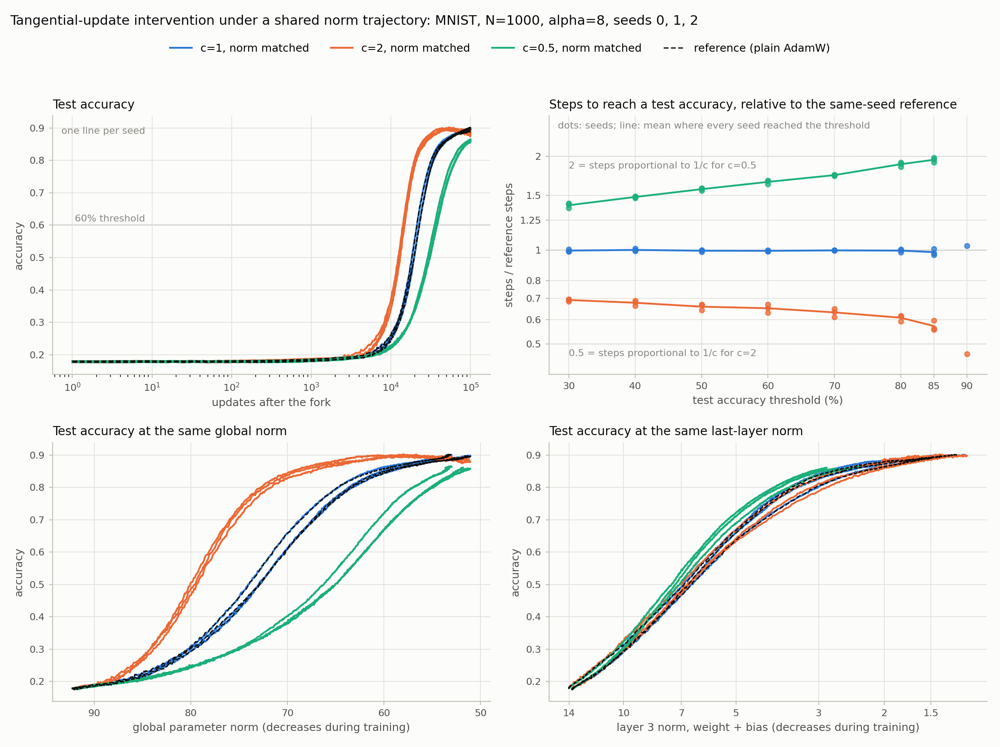

# MNIST 方向干预：相同范数轨迹下改变切向更新

检验 [实验思路](../../../Grokking实验思路.md) 中的备择假设：**各组全局参数范数在每一步都相同时，改变切向（方向）更新幅度是否仍会改变泛化出现的时间。** seeds **0、1、2** 已在 A100 上完成：每个 seed 包含参考运行与 c=1、2、0.5 三个干预组，分叉后各 100,000 次更新、1,181 个完整评估点。

| 组 | 做法 | 用途 |
|---|---|---|
| `ref` | 普通 AdamW，不做改动 | 参考曲线，并定义逐步范数轨迹 R_t |
| `c=1` | 分解后原样重组，每步缩放到 R_t | 重放控制：验证恢复、分解与投影 |
| `c=2` | 切向分量乘 2，每步缩放到 R_t | 放大方向更新 |
| `c=0.5` | 切向分量乘 0.5，每步缩放到 R_t | 减小方向更新 |

[三 seed 结果摘要](results/SUMMARY.md) · [曲线与逐步数据](results/direction/) · [配置](configs/direction/) · [验证记录](metadata/direction/)



每个 seed 另有两张图（把文件名里的 `seed0` 换成 `seed1`、`seed2`）：[曲线、范数与范数误差](figures/direction/direction_curves_seed0.png)、[角度、与参考的距离、逐层范数](figures/direction/direction_diagnostics_seed0.png)。

## 结果

**结论：三个 seed 一致支持备择假设的弱形式，即全局范数轨迹逐步相同，泛化等待步数仍随切向更新幅度单调改变。数据不支持"方向优化是唯一或主要瓶颈"这一更强的说法。**

下面的"均值 ± 标准差"都是 3 个 seed 的结果，标准差按 n−1 计算。

### 控制成立

| seed | 分叉步 | 检查点恢复：参数最大绝对差 | c=1 重放：前 1,000 步相对距离 | 范数匹配：全部 100,000 步最大相对误差 | c=1 短程校验 |
|---:|---:|---:|---:|---:|---|
| 0 | 1,800 | 1.3e-14 | 1.5e-14 | 6.0e-16 | 通过 |
| 1 | 1,700 | 4.9e-14 | 1.7e-14 | 6.4e-16 | 通过 |
| 2 | 1,900 | 7.9e-15 | 2.7e-11 | 6.4e-16 | 通过 |
| 判据 | | ≤ 1e-9 × 范数 | ≤ 1e-9 | ≤ 1e-10 | |

- 三个 seed 的三项校验全部通过，训练代码的 SHA256 相同，没有任何组出现非有限损失。
- seed 2 的重放距离（2.7e-11）比另外两个 seed 大三个数量级，但仍比判据小约 36 倍。原因是这个 seed 的舍入误差在 1,000 步之前就开始被放大（第 500 步为 8e-15）。
- 训练拟合没有因干预变差：各组分叉后的最低训练准确率为 98.9%–99.2%，最多比分叉时低 1 个样本；末步全部为 100%。

### 泛化等待步数随 c 单调变化

步数自分叉点起算，为测试准确率首次达到阈值的评估步。单元格为三个 seed 的均值（最小–最大）。

| 组 | ≥60%（主阈值） | ≥70% | ≥80% | ≥85% | 末步测试准确率 | 最高测试准确率 |
|---|---:|---:|---:|---:|---:|---:|
| ref | 22,267（21,200–22,800） | 26,333（25,100–27,000） | 33,467（32,000–34,300） | 43,900（42,500–44,700） | 89.6% | 89.7% |
| c=1 | 22,167（21,200–22,700） | 26,300（25,100–26,900） | 33,367（32,200–34,100） | 43,300（41,100–45,200） | 89.7% | 89.8% |
| c=2 | 14,500（14,200–14,900） | 16,633（16,300–17,100） | 20,333（19,700–21,000） | 25,100（23,900–26,600） | 88.5% | 89.9% |
| c=0.5 | 36,867（35,400–38,100） | 45,833（43,800–47,100） | 63,167（59,300–65,200） | 85,600（81,300–88,000） | 86.1% | 86.1% |

与同 seed 参考运行的步数之比：

| 阈值 | c=1 | c=2 | c=0.5 |
|---:|---:|---:|---:|
| 30% | 0.997 ± 0.009 | 0.693 ± 0.006 | 1.394 ± 0.024 |
| 60%（主阈值） | 0.996 ± 0.004 | 0.652 ± 0.019 | 1.656 ± 0.025 |
| 80% | 0.997 ± 0.011 | 0.608 ± 0.014 | 1.887 ± 0.030 |
| 85% | 0.986 ± 0.023 | 0.572 ± 0.021 | 1.949 ± 0.033 |

- **方向一致。** 在 30%–85% 的 7 个阈值上，三个 seed 的 c=2 全部早于参考，c=0.5 全部晚于参考。
- **效应远大于波动。** 达到 60% 时，c=2 比同 seed 参考早 7,000–8,400 步，c=0.5 晚 14,200–15,300 步；参考运行的 seed 间标准差为 924 步，c=1 与参考最多相差 200 步。
- **验证集给出相同结果。** 验证准确率达到 60% 的步数之比为 0.653 ± 0.021（c=2）和 1.655 ± 0.018（c=0.5）。
- **90% 只有 seed 1 达到**：参考 93,800 步，c=2 43,600 步，c=0.5 在预算内未达到。
- 60% 是运行前固定的主阈值。30%–50% 是事后补充的，只用来检查结论是否依赖阈值；完整的 8 个阈值见[结果摘要](results/SUMMARY.md)第 3 节。

### 相同全局范数对应很不相同的测试准确率

每个 seed 取参考范数首次降到该值的评估步，此时四组范数相同。单元格为测试准确率的均值（最小–最大），单位 %。

| 全局范数 | ref | c=1 | c=2 | c=0.5 |
|---:|---:|---:|---:|---:|
| 80 | 30.1（29.4–30.7） | 30.5（29.6–31.1） | 48.8（46.7–50.6） | 24.6（24.3–24.8） |
| 75 | 44.1（42.6–46.1） | 44.0（42.6–46.0） | 72.5（70.8–73.7） | 30.3（29.9–30.6） |
| 70 | 62.6（60.8–65.8） | 62.8（61.2–65.9） | 83.6（82.8–84.5） | 38.9（37.9–40.1） |
| 65 | 77.5（76.1–79.7） | 77.6（76.6–79.4） | 87.5（86.8–88.2） | 51.6（50.2–54.3） |

范数为 70 时，c=2 与 c=0.5 平均相差 45 个百分点，三个 seed 的取值范围互不重叠（上图左下）。在所测设置中，全局范数的数值不能单独决定测试准确率。

### 效应小于按 1/c 成比例的预期

如果只有方向更新在限速，c 翻倍应使等待步数接近减半。实际在 60% 阈值上 c=2 为 0.65 倍、c=0.5 为 1.66 倍。把步数写成 c^(−p)，p 从 30% 阈值的约 0.5 升到 85% 阈值的约 0.8（c=2）和约 1.0（c=0.5）（上图右上）。范数收缩等其他过程也在共同限速，且越靠后的阶段对 c 越敏感。

c 也不等于实际方向变化的倍数：全程累计角度为参考的 1.24 倍（c=2，1.20–1.27）和 0.55 倍（c=0.5，0.54–0.56）。c=2 的每步角度在最初 100 步是参考的 2.3–2.8 倍，前 3,000 步平均是 4.0–6.2 倍，之后差距缩小。

### 最后一层的范数是一个更具体的竞争解释

全局范数匹配，逐层范数并不匹配。各组达到同一测试准确率时（均值，最小–最大）：

| 阈值 | 组 | 全局范数 | 第 3 层范数 | 累计角度 (rad) |
|---:|---|---:|---:|---:|
| 60% | ref | 70.6（70.1–71.5） | 5.57（5.40–5.69） | 9.8（8.9–10.3） |
| 60% | c=2 | 77.8（77.5–78.1） | 5.56（5.41–5.78） | 8.8（8.2–9.3） |
| 60% | c=0.5 | 62.4（61.9–63.3） | 6.18（5.97–6.33） | 10.8（10.2–11.1） |
| 80% | ref | 63.9（63.3–64.8） | 3.35（3.05–3.54） | 17.9（16.6–18.6） |
| 80% | c=2 | 72.2（71.6–72.8） | 3.13（2.86–3.42） | 14.5（13.4–15.4） |
| 80% | c=0.5 | 55.7（54.9–57.0） | 3.79（3.60–3.95） | 22.8（21.0–24.0） |

- 同一准确率下，全局范数在组间相差约 25%–30%，第 3 层范数相差约 10%（60% 阈值）到 20%（80% 阈值）。测试准确率对第 3 层范数作图时，四组曲线接近重合，但 c=0.5 始终偏高（上图右下）。
- 同一步数下第 3 层范数差别很大：分叉后 20,000 步时为 5.9–6.7（参考）、2.8–3.5（c=2）、9.2–9.7（c=0.5），对应的测试准确率为 51%–56%、79%–80%、33%–35%。
- 所以 c 改变的很可能是范数从最后一层向前两层重新分配的速度。层间重新分配在全局参数空间里属于切向运动，这与弱假设不矛盾，但它指向"起作用的是另一种范数"，而不是泛指的方向优化。目前这只是相关性，没有做逐层匹配范数的干预。
- 累计角度也不是充分的状态变量：累计角度同为 10 rad 时，测试准确率为 61.3%（参考）、67.2%（c=2）、57.6%（c=0.5）。

### 更早泛化不等于最终更好

- c=2 的测试准确率在分叉后 47,900–56,200 步达到最高（89.8%–90.2%），之后回落 0.9–2.2 个百分点；三个 seed 的末步都低于同 seed 参考（−0.8 到 −1.4 个百分点），验证集同样（−0.5 到 −1.5）。
- c=0.5 到预算结束时仍在缓慢上升，末步比参考低 2.9–3.8 个百分点，不能当作最终水平。
- 末段 30,000 步的训练 MSE 中位数：参考 6.8e-6–9.4e-6，c=2 1.4e-6–1.9e-6，c=0.5 1.5e-5–1.9e-5。c=2 的训练拟合最紧，测试准确率却在回落。

### 噪声底：三种来源

| 来源 | 60% 步数的差别 | 说明 |
|---|---:|---|
| c=1 对参考（同 seed，只差舍入） | 0–200 步 | 30%–70% 阈值最多 200 步，80% 最多 500 步，85% 最多 1,400 步 |
| 同一 seed 换硬件与 PyTorch 版本 | 0–200 步 | seed 0 在本机 RTX 5060 上先跑过一次；80%、85% 阈值最多相差 1,100、2,300 步 |
| 不同 seed 的参考运行 | 标准差 924 步 | 范围 21,200–22,800 |

- c=1 与参考每步只差约 1e-16 的投影舍入误差。分叉后约 3,000 步起，包括参考在内的各组训练 MSE 反复出现尖峰（最高约 1e-2 到 4e-2），参考组每步角度的中位数由约 4e-5 升到约 4e-4 rad。这是该设置下普通 AdamW 自身的行为。舍入差在这一阶段被放大：c=1 与参考的相对距离在 10,000 步时为 1e-2 到 2e-2，末步为 0.56–0.61，参数已明显不同。
- 但 c=1 与参考的测试准确率全程最多相差 0.7–0.9 个百分点。因此重放判据只取前 1,000 步，整段偏离作为噪声底报告。
- 本机与 A100 的 seed 0 分叉步相同，分叉后 5,800 步内范数相对差小于 1e-9，之后分开，测试准确率最多相差 1.0–1.4 个百分点（[对比记录](metadata/direction/seed0_local_rtx5060.json)）。发布的 seed 0 数据是 A100 的那一次。
- 阈值越高，曲线越平，同样的准确率波动对应的步数差越大；85% 以上的步数应看比值的范围，不要看单个数。

### 结论边界

- 支持的说法：在所测的 MNIST 设置和三个 seed 中，全局范数轨迹逐步相同，泛化等待步数仍随切向更新幅度单调改变（60% 阈值上 c=2 约 0.65 倍，c=0.5 约 1.66 倍），全局范数轨迹不是泛化时间的充分解释。
- 不能推出方向优化是唯一或主要瓶颈。效应小于按 1/c 成比例的预期；干预同时改变了之后的梯度、AdamW 状态和逐层范数分配。
- 没有否定权重衰减或范数收缩的作用：四组都在范数下降的过程中泛化，本实验没有范数不下降的对照。
- seed 只改变初始化和批次顺序，训练子集固定为前 1,000 个样本。结论限于 N=1000、alpha=8、weight decay=0.01 这一个设置和 c ∈ {0.5, 1, 2}。
- 3 个 seed 足以看出方向和量级，不足以给出可靠的置信区间。

## 协议

| 项目 | 设置 |
|---|---|
| 数据 | MNIST，固定前 1,000 个训练样本；验证集为训练图像 50000–59999；测试集 10,000 个样本 |
| 网络 | 784→200→200→10，隐藏层 ReLU，含 bias；官方 Kaiming uniform 初始化后全部参数乘 alpha=8 |
| 训练损失 | one-hot 标签的 element-mean MSE |
| 优化器 | AdamW，lr=0.001，weight_decay=0.01，其余为默认值（官方 notebook 默认设置） |
| 分叉 | 训练准确率首次 ≥ 99% 的评估步；seeds 0、1、2 分别为第 1,800、1,700、1,900 步，此时测试准确率 17.7%–18.0%，范数 91.8–92.3 |
| 预算 | 分叉后每组 100,000 次更新，batch=200；参考范数降到 51.3–53.1 |
| 批次 | 同一 seed 的四组共用同一个批次序列；采样器种子 `seed*1000000 + 10*N` |
| 精度 | FP64，关闭 TF32 |

分叉规则不看验证集和测试集。测试集只按固定评估点记录，没有用于选择分叉点、c 或阈值。c 的取值和 60% 主阈值在运行前已固定。

### 干预

把全部权重和 bias 按 w1、w2、w3、b1、b2、b3 的顺序拼成向量 θ。每一步先做一次普通 AdamW 更新，得到实际更新 Δ_t，再对干预组分解并缩放：

$$\theta^*_{t+1}=\theta_t+\Delta_{\parallel,t}+c\,\Delta_{\perp,t},\qquad \theta_{t+1}=R_{t+1}\frac{\theta^*_{t+1}}{\|\theta^*_{t+1}\|_2}$$

其中 Δ∥ 是 Δ_t 沿 θ_t 方向的分量，Δ⊥ 是其余部分，R_{t+1} 是参考组在同一步之后的范数。AdamW 的动量和二阶矩在干预后照常连续更新，不重置。

### 实现与验证

- **各组同时运行。** 分叉后把检查点复制成 4 个切片堆叠训练，每一步参考切片先得到 R_{t+1}，其余切片立即投影到它。这与"先跑参考、再重放范数"等价，但批次顺序必然相同，时间减半。
- **训练部件未重写。** 模型、批次采样器、AdamW 更新和数据转换直接从 [run_dynamics.py](../mnist_dynamics/code/run_dynamics.py) 导入。每个 seed 运行前都用它的 `--validate` 对照官方 notebook 循环 50 步，A100 上参数最大绝对差为 1.7e-14，判据 1e-9（[记录](metadata/direction/validation.json)）。
- **范数从参数重新读取。** 记录的范数是写回参数之后重新计算的，不是投影公式的目标值。
- **三项校验决定可否解释。** 检查点恢复、c=1 重放、范数匹配全部通过，`interpretable` 才为 true；否则训练脚本以退出码 3 结束。

与实验思路文档的差异：

- 参考组与干预组同时运行，而不是两遍。
- 分叉条件只用训练准确率 ≥ 99%，没有加训练 MSE 阈值（可用 `--fit-train-mse` 添加）。
- 角度用 `2·atan2(‖u'−u‖, ‖u'+u‖)` 计算，与 `arccos(u·u')` 等价，但在每步角度约 1e-5 rad 时不丢精度。

### 指标口径

- `train_accuracy`/`val_accuracy`/`test_accuracy`：完整训练子集、验证集、测试集的准确率，0–1 比例。
- `train_loss`/`val_loss`/`test_loss`：十个输出平方误差之和的样本均值，与 `mnist_dynamics` 相同。`train_mse` = `train_loss`/10，即训练用的 MSE。
- `steps_since_fork`：分叉后的更新次数；`step` = 分叉步 + `steps_since_fork`。
- `steps_to_test_XX`：测试准确率首次 ≥ XX% 的评估步（自分叉起）。预算内未达到时为空。1,000 步之后的分辨率为 100 步。
- `global_norm`、`reference_norm`、`norm_relative_error`：该组范数、参考组范数 R_t、两者的相对差。
- `cumulative_angle_rad`：每步方向夹角的累加。
- `summary_by_condition.csv` 的 `vs_reference_*`：与同 seed 参考运行配对后的统计；步数和角度取比值，准确率取差值。有 seed 未达到阈值时，均值等列留空，`values_by_seed` 中记为 `NA`。
- 评估日程：分叉后 0–99 步逐步，100–990 步每 10 步，此后每 100 步。

## 文件

| 路径 | 用途 |
|---|---|
| `code/run_direction.py` | 训练到分叉点、堆叠四组、逐步干预与记录、三项校验 |
| `code/make_direction_figures.py` | 单个 seed 的两张图和分析 |
| `code/collect_results.py` | 把一次运行导出为 `configs/`、`results/`、`metadata/`，并写哈希清单 |
| `code/summarize_seeds.py` | 跨 seed 汇总：条件汇总表、汇总图、结果摘要 |
| `code/verify_results.py` | 只用标准库：检查哈希，从 CSV 独立复算阈值步数、逐步范数误差和跨 seed 汇总表 |
| `results/SUMMARY.md` | 自动生成的三 seed 结果摘要 |
| `results/direction/all_seeds_curves.csv` | 每个 seed、每组、每个评估点的准确率、损失、范数、累计角度、逐层范数（14,172 行） |
| `results/direction/time_to_generalize_all_seeds.csv` | 每个 seed、每组的阈值步数、末步与最高准确率、范数误差、角度统计 |
| `results/direction/summary_by_condition.csv` | 每组每个指标的跨 seed 均值、标准差、范围，以及与同 seed 参考的配对统计 |
| `results/direction/seed<k>_per_step.csv` | 逐步记录：参考范数轨迹 R_t、各组范数与相对误差、每步角度、minibatch MSE（每个 100,001 行，约 21 MB） |
| `results/direction/seed<k>_analysis.md` | 自动生成的单 seed 分析 |
| `figures/direction/` | 汇总图 `direction_seeds012` 与每个 seed 的两张图，PNG 与 PDF |
| `configs/direction/seed<k>.json` | 完整配置与代码 SHA256 |
| `metadata/direction/` | 每个 seed 的 QA 与 c=1 短程校验、官方循环验证、seed 0 本机运行与 A100 运行的对比 |
| `metadata/*.json` | 环境、包版本、来源（环境为最后导出的 seed，三个 seed 相同） |
| `manifest_sha256.json` | 本材料各文件的相对路径与 SHA256 |
| `run_a100.sh` | 在 Jetstream2 GPU 实例上一条命令跑完一个 seed 的闭环 |

以下内容只在本机 `generated/direction/`，不纳入 Git：每个 seed 的 `history.npz`（全部逐步量，约 26 MB）、分叉与末步检查点、日志；`seed0_local_rtx5060_export/` 是 seed 0 本机运行导出结果的备份。`.venv/`、`data/`、`generated/` 和 `*.log` 都已被仓库的 `.gitignore` 排除。本目录的全部文件目前都没有提交。

## 运行

先进入本目录。

### 校验现有结果

```bash
python code/verify_results.py
```

### 在 A100 上运行

按课程的 [Jetstream2 指南](https://github.com/Saipraneet/jetstream2-guide) 配置好 `js2` 后，在本机仓库根目录执行 `js2 launch mybox`、`js2 setup mybox`、`js2 push-code mybox`，登录后在 tmux 里运行：

```bash
cd "/workspace/CSCI567_Grokking/Project check-in/实验部分/mnist_direction" && bash run_a100.sh 0
```

参数是 seed。脚本依次执行环境检查、官方循环验证、c=1 短程校验、正式运行和作图，任何一步失败都会中止。跑完后用 `js2 pull-results mybox` 取回结果，再用 `js2 stop mybox` 停机，否则一直计费。

实测耗时（A100-SXM4-40GB，Python 3.12.3，PyTorch 2.15.0+cu132）：

| 步骤 | 每个 seed |
|---|---:|
| c=1 短程校验（分叉后 2,000 步） | 7 秒 |
| 正式运行（分叉后 100,000 步，四个切片） | 5.3–5.4 分钟，约 310–315 步/秒 |
| 整个脚本，从官方循环验证到作图 | 约 6 分钟 |

三个 seed 的脚本运行时间合计约 18 分钟，按 `a100-10` 的 16 credits/小时约 5 credits；开机、环境安装和两次运行之间的空闲另计。此前估计的每个 seed 5–15 分钟与实测相符。

### 导出取回的结果

取回的运行在 `generated/direction/seed<k>/`。导出需要 numpy 和 matplotlib：

```bash
python -m pip install -r requirements-analysis.txt
```

对每个 seed 执行下面两条（示例为 seed 0）：

```bash
python code/make_direction_figures.py --root generated/direction/seed0/full --export .
```

```bash
python code/collect_results.py --run generated/direction/seed0/full --gate generated/direction/seed0/gate --validation generated/direction/seed0/official_validation/validation.json
```

全部 seed 导出后生成跨 seed 汇总、重写清单并校验：

```bash
python code/summarize_seeds.py
```

```bash
python code/collect_results.py --manifest-only
```

```bash
python code/verify_results.py
```

- `collect_results.py` 会保留 CSV 中其他 seed 的行，同一 seed 重新导出时替换原有行。
- 修改 README 或图之后，同样用 `--manifest-only` 重写清单。

### 在本机从头运行

依赖与 `mnist_dynamics` 相同。seed 0 曾在本机跑过一次：Windows 11，RTX 5060 8 GB，Python 3.13.14，PyTorch 2.8.0+cu128，c=1 短程校验 1.0 分钟，正式运行 17.4 分钟（约 96 步/秒）。

```bash
python -m venv .venv
```

```bash
.venv/Scripts/python.exe -m pip install -r requirements-train.txt
```

依次执行官方循环验证、c=1 短程校验、正式运行：

```bash
.venv/Scripts/python.exe ../mnist_dynamics/code/run_dynamics.py --experiment notebook --root generated/direction/seed0/official_validation --data-root data --validate
```

```bash
.venv/Scripts/python.exe code/run_direction.py --root generated/direction/seed0/gate --data-root data --seed 0 --cs 1 --steps 2000
```

```bash
.venv/Scripts/python.exe code/run_direction.py --root generated/direction/seed0/full --data-root data --seed 0 --cs 1 2 0.5 --steps 100000
```

- 换 seed 时修改 `--seed` 和各个 `--root`。
- 同一个 `--root` 不能重复写入已完成的运行；`generated/direction/seed0`–`seed2` 现在放的是 A100 的结果，重跑前先换一个目录名。
- 没有 GPU 时可加 `--device cpu` 做冒烟测试，本机 CPU 约 12 步/秒。
- 不同硬件或 PyTorch 版本得到的曲线不会逐位相同，差别的量级见上文"噪声底"。

## 未做的后续实验：逐层匹配范数的干预

**这一节只是设计说明。实验没有运行，代码没有实现，下面没有任何结果。**

### 为什么需要

现有干预只匹配全局范数。按全局方向分解时，"范数在层间重新分配"属于切向分量，会被 c 一起放大或缩小。现有数据因此无法区分两种解释：

| 解释 | 内容 | 现有数据中的迹象 |
|---|---|---|
| A：层间范数分配 | c 改变的是范数从最后一层移向前两层的速度；决定泛化的是逐层范数（尤其是第 3 层） | 各组达到同一测试准确率时第 3 层范数接近，全局范数相差 25%–30% |
| B：层内方向 | 即使每一层的范数都相同，层内方向更新的快慢仍然改变泛化时间 | 尚无直接证据 |

两种解释都与"全局范数轨迹不是充分解释"相容，但对原论文的含义不同：A 更接近"需要换一个更细的范数变量"，B 才是备择假设想说的方向优化。

### 干预

把参数按层分成三块，第 ℓ 层 θ^(ℓ) 包含该层的权重和 bias（与已记录的 `norm_layer1`–`norm_layer3` 口径相同）。每一步先做普通 AdamW 更新，再对每一层单独分解并缩放：

$$\theta^{(\ell)*}_{t+1}=\theta^{(\ell)}_t+\Delta^{(\ell)}_{\parallel,t}+c\,\Delta^{(\ell)}_{\perp,t},\qquad \theta^{(\ell)}_{t+1}=R^{(\ell)}_{t+1}\frac{\theta^{(\ell)*}_{t+1}}{\|\theta^{(\ell)*}_{t+1}\|_2}$$

其中 Δ∥^(ℓ) 是该层更新沿 θ^(ℓ) 方向的分量，Δ⊥^(ℓ) 是该层内的其余部分，R^(ℓ)_{t+1} 是参考组同一层在同一步之后的范数。三层范数都匹配后，全局范数自动匹配。与现有干预的唯一区别是：层间重新分配不再乘 c，而是被固定在参考轨迹上。

### 分组与预先固定的设置

| 组 | 做法 | 用途 |
|---|---|---|
| `ref` | 普通 AdamW | 参考曲线，定义三条逐层范数轨迹 |
| 逐层 `c=1` | 逐层分解后原样重组并缩放 | 重放控制 |
| 逐层 `c=2`、`c=0.5` | 层内切向分量乘 c，逐层缩放 | 待检验的干预 |
| 全局 `c=2`、`c=0.5` | 现有干预，放在同一次堆叠运行里 | 同批次、同硬件下的直接对照 |

- 其余全部沿用本实验：seeds 0、1、2，相同的分叉规则与分叉点，分叉后 100,000 步，四组以上共用同一个批次序列，FP64。
- 主指标仍是 60% 测试准确率的等待步数与同 seed 参考之比，c 的取值不变。这些在运行前固定，不根据结果调整。
- 校验在现有三项之外增加一项：每一层的范数与参考的相对误差在每一步都 ≤ 1e-10。任何一项不通过，结果不解释。

### 结果如何解读

以现有结果为基准：全局干预的比值为 0.65（c=2）和 1.66（c=0.5），c=1 的比值为 0.996 ± 0.004，参考运行的 seed 间标准差约为均值的 4%。

| 逐层干预的结果 | 解读 |
|---|---|
| 比值回到 1 附近（与 c=1 的差别不超过噪声底），且三个 seed 一致 | 现有效应主要来自层间范数分配，支持解释 A；"方向更新影响泛化时间"的说法需要收窄为"逐层范数分配影响泛化时间" |
| 比值仍接近 0.65 和 1.66 | 逐层范数全部相同时效应仍在，支持解释 B；这是对备择假设更强的证据 |
| 比值介于两者之间，方向仍为 c=2 提前、c=0.5 延后 | 两者都有贡献；报告逐层干预保留了全局干预效应的多大比例，不做二选一的结论 |
| c=2 与 c=0.5 不再呈相反方向，或训练拟合明显变差 | 干预本身破坏了优化，不能用于区分 A 与 B |

无论哪种结果，都仍然不能说明权重衰减不必要：各组的逐层范数都在下降。逐层匹配也没有匹配内部表征，支持 B 的结果只能说明"逐层范数轨迹不是充分解释"。

### 实现要点与预计成本

- 改动集中在 `run_direction.py` 的逐步干预：目前按整条参数向量（顺序 w1 w2 w3 b1 b2 b3）分解，需要改为按层的索引集合分别分解和缩放，并用一个选项区分全局匹配与逐层匹配的切片。
- 逐层范数已经逐步记录（`layer_norms_squared`），只需增加逐层范数误差的校验与导出列；作图和汇总脚本按组名区分两类干预即可复用。
- 一次运行堆叠 6 个切片（现在是 4 个）。A100 上 4 个切片的正式运行实测为每个 seed 5.3–5.4 分钟；6 个切片的耗时没有测过，预计每个 seed 在 10 分钟以内。
- 实现后应先跑 2,000 步的逐层 c=1 短程校验，再跑正式运行，与现有流程一致。

## 后续交接

1. 三个 seed 的闭环已完成，可用于 report。引用时写明：N=1000、alpha=8、weight decay=0.01，3 个 seed，训练子集固定；60% 是预先固定的主阈值。
2. 报告里可以直接使用的表述：全局范数轨迹逐步相同，60% 测试准确率的等待步数在 c=2 时为参考的 0.65 ± 0.02 倍，在 c=0.5 时为 1.66 ± 0.03 倍；因此全局范数轨迹不是泛化时间的充分解释。不要写成"方向优化是瓶颈"。
3. 最值得跟进的是**逐层匹配范数的干预**，设计见上一节，尚未实现和运行。报告中提到层间范数分配时，应写明它目前只是相关性。
4. 其次是范数不下降的对照（weight decay=0 或把范数固定在分叉时的值），用来回答范数收缩是否必要。
5. c=2 后期测试准确率回落；如需更温和的放大组或更细的剂量关系，可加 `--cs 1 2 0.5 1.5 0.75`。
