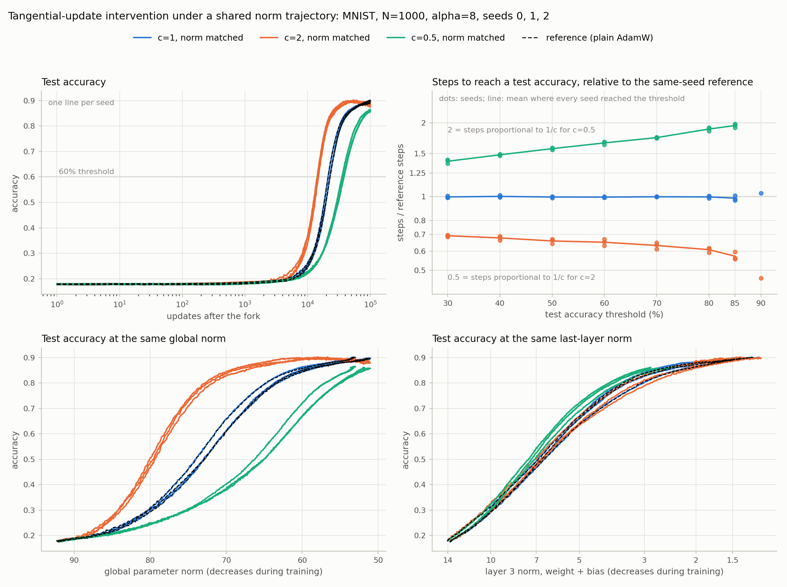

# 方向干预实验结果摘要（seeds 0、1、2）

本文件由 `code/summarize_seeds.py` 根据 `results/direction/` 下的 CSV 与 `metadata/direction/` 下的校验记录自动生成。每个 seed 的单独分析见 [seed 0](direction/seed0_analysis.md)、[seed 1](direction/seed1_analysis.md)、[seed 2](direction/seed2_analysis.md)。

## 1. 运行与校验

运行环境（最后导出的 seed）：NVIDIA A100-SXM4-40GB，PyTorch 2.15.0+cu132，float64。

| seed | 分叉步 | 分叉时测试准确率 | 分叉时范数 | 参考末步范数 | 检查点恢复：参数最大绝对差 | c=1 重放：前 1,000 步相对距离 | 范数匹配：最大相对误差 | c=1 短程校验 | 分叉后耗时 |
|---:|---:|---:|---:|---:|---:|---:|---:|---|---:|
| 0 | 1,800 | 18.0% | 91.84 | 51.82 | 1.3e-14 | 1.5e-14 | 6.0e-16 | 通过 | 5.4 分钟 |
| 1 | 1,700 | 17.7% | 92.10 | 53.06 | 4.9e-14 | 1.7e-14 | 6.4e-16 | 通过 | 5.3 分钟 |
| 2 | 1,900 | 17.9% | 92.26 | 51.35 | 7.9e-15 | 2.7e-11 | 6.4e-16 | 通过 | 5.4 分钟 |

判据：检查点恢复 ≤ 1e-9 × 范数，c=1 重放 ≤ 1e-9，范数匹配 ≤ 1e-10。全部 seed 的三项校验均通过。

## 2. 泛化等待步数（自分叉点起，测试准确率首次达到阈值）

| 组 | seed | ≥60% | ≥70% | ≥80% | ≥85% | ≥90% | 验证 ≥60% | 末步测试 | 最高测试 |
|---|---:|---:|---:|---:|---:|---:|---:|---:|---:|
| ref | 0 | 22,800 | 27,000 | 34,300 | 44,500 | 未达到 | 22,500 | 89.0% | 89.1% |
| ref | 1 | 21,200 | 25,100 | 32,000 | 42,500 | 93,800 | 21,100 | 90.1% | 90.2% |
| ref | 2 | 22,800 | 26,900 | 34,100 | 44,700 | 未达到 | 22,700 | 89.7% | 89.7% |
| ref | **均值** | **22,267** | **26,333** | **33,467** | **43,900** | — | **22,100** | **89.6%** | **89.7%** |
| c=1 | 0 | 22,700 | 26,900 | 33,800 | 43,600 | 未达到 | 22,400 | 89.4% | 89.4% |
| c=1 | 1 | 21,200 | 25,100 | 32,200 | 41,100 | 96,900 | 21,100 | 90.0% | 90.1% |
| c=1 | 2 | 22,600 | 26,900 | 34,100 | 45,200 | 未达到 | 22,600 | 89.7% | 89.8% |
| c=1 | **均值** | **22,167** | **26,300** | **33,367** | **43,300** | — | **22,033** | **89.7%** | **89.8%** |
| c=2 | 0 | 14,400 | 16,500 | 20,300 | 24,800 | 未达到 | 14,200 | 87.6% | 89.8% |
| c=2 | 1 | 14,200 | 16,300 | 19,700 | 23,900 | 43,600 | 14,200 | 89.3% | 90.2% |
| c=2 | 2 | 14,900 | 17,100 | 21,000 | 26,600 | 未达到 | 14,900 | 88.6% | 89.8% |
| c=2 | **均值** | **14,500** | **16,633** | **20,333** | **25,100** | — | **14,433** | **88.5%** | **89.9%** |
| c=0.5 | 0 | 38,100 | 47,100 | 65,000 | 88,000 | 未达到 | 37,500 | 86.1% | 86.1% |
| c=0.5 | 1 | 35,400 | 43,800 | 59,300 | 81,300 | 未达到 | 35,100 | 86.5% | 86.5% |
| c=0.5 | 2 | 37,100 | 46,600 | 65,200 | 87,500 | 未达到 | 37,100 | 85.8% | 85.8% |
| c=0.5 | **均值** | **36,867** | **45,833** | **63,167** | **85,600** | — | **36,567** | **86.1%** | **86.1%** |

"未达到"表示在预算内没有达到该阈值；有 seed 未达到时不计算均值。1,000 步之后评估间隔为 100 步。

## 3. 与同 seed 参考运行的步数之比

60% 是运行前固定的主阈值；其余阈值用于检查结论是否依赖阈值，30%–50% 是事后补充的。

| 阈值 | c=1：各 seed | c=1：均值 ± 标准差 | c=2：各 seed | c=2：均值 ± 标准差 | c=0.5：各 seed | c=0.5：均值 ± 标准差 |
|---:|---|---:|---|---:|---|---:|
| 30% | 1.008、0.992、0.992 | 0.997 ± 0.009 | 0.686、0.697、0.695 | 0.693 ± 0.006 | 1.413、1.402、1.367 | 1.394 ± 0.024 |
| 40% | 1.012、1.000、0.994 | 1.002 ± 0.009 | 0.665、0.690、0.681 | 0.679 ± 0.013 | 1.491、1.484、1.470 | 1.481 ± 0.011 |
| 50% | 1.000、0.989、1.000 | 0.996 ± 0.006 | 0.643、0.670、0.665 | 0.659 ± 0.015 | 1.582、1.573、1.553 | 1.569 ± 0.015 |
| 60% | 0.996、1.000、0.991 | 0.996 ± 0.004 | 0.632、0.670、0.654 | 0.652 ± 0.019 | 1.671、1.670、1.627 | 1.656 ± 0.025 |
| 70% | 0.996、1.000、1.000 | 0.999 ± 0.002 | 0.611、0.649、0.636 | 0.632 ± 0.019 | 1.744、1.745、1.732 | 1.741 ± 0.007 |
| 80% | 0.985、1.006、1.000 | 0.997 ± 0.011 | 0.592、0.616、0.616 | 0.608 ± 0.014 | 1.895、1.853、1.912 | 1.887 ± 0.030 |
| 85% | 0.980、0.967、1.011 | 0.986 ± 0.023 | 0.557、0.562、0.595 | 0.572 ± 0.021 | 1.978、1.913、1.957 | 1.949 ± 0.033 |
| 90% | —、1.033、— | — | —、0.465、— | — | —、—、— | — |

若等待步数与 1/c 成正比，c=2 的比值应为 0.5，c=0.5 应为 2。标准差按 n−1 计算，只有 3 个 seed。

## 4. 相同全局范数处的测试准确率

每个 seed 取参考范数首次降到该值以下的评估步（各组在这一步的范数相同）。单元格为各 seed 均值（最小–最大），单位 %。

| 全局范数 ≤ | 分叉后步数 | ref | c=1 | c=2 | c=0.5 |
|---:|---:|---:|---:|---:|---:|
| 85 | 7700（7500–7900） | 22.0（21.7–22.3） | 22.0（21.6–22.3） | 27.1（26.6–27.7） | 20.8（20.4–21.0） |
| 80 | 12400（12300–12500） | 30.1（29.4–30.7） | 30.5（29.6–31.1） | 48.8（46.7–50.6） | 24.6（24.3–24.8） |
| 75 | 17333（17300–17400） | 44.1（42.6–46.1） | 44.0（42.6–46.0） | 72.5（70.8–73.7） | 30.3（29.9–30.6） |
| 70 | 23133（23000–23200） | 62.6（60.8–65.8） | 62.8（61.2–65.9） | 83.6（82.8–84.5） | 38.9（37.9–40.1） |
| 65 | 31100（30600–31600） | 77.5（76.1–79.7） | 77.6（76.6–79.4） | 87.5（86.8–88.2） | 51.6（50.2–54.3） |
| 60 | 44367（43000–46100） | 84.9（84.2–85.7） | 85.2（84.5–86.1） | 89.5（89.3–89.7） | 68.6（66.8–72.0） |
| 55 | 66933（64900–69700） | 88.1（87.9–88.6） | 88.3（88.0–88.6） | 89.4（89.0–89.6） | 81.2（79.9–83.3） |

## 5. 达到同一测试准确率时的状态

单元格为各 seed 均值（最小–最大）。

| 阈值 | 组 | 全局范数 | 累计角度 (rad) | 第 1 层范数 | 第 2 层范数 | 第 3 层范数 |
|---:|---|---:|---:|---:|---:|---:|
| 40% | ref | 76.2（75.7–76.8） | 6.0（5.5–6.5） | 55.2（54.8–55.6） | 51.9（51.6–52.3） | 8.14（8.00–8.40） |
| 40% | c=1 | 76.2（75.8–76.8） | 6.0（5.5–6.5） | 55.2（54.9–55.6） | 51.9（51.6–52.3） | 8.09（7.97–8.32） |
| 40% | c=2 | 81.6（81.3–81.8） | 6.0（5.6–6.5） | 59.4（59.2–59.6） | 55.3（55.1–55.5） | 8.22（7.99–8.57） |
| 40% | c=0.5 | 69.5（68.9–70.1） | 5.7（5.4–6.0） | 49.8（49.3–50.3） | 47.7（47.4–48.1） | 8.57（8.42–8.81） |
| 60% | ref | 70.6（70.1–71.5） | 9.8（8.9–10.3） | 52.2（51.9–52.8） | 47.3（46.9–47.9） | 5.57（5.40–5.69） |
| 60% | c=1 | 70.7（70.3–71.5） | 9.7（8.9–10.2） | 52.2（52.0–52.8） | 47.3（47.0–48.0） | 5.60（5.40–5.78） |
| 60% | c=2 | 77.8（77.5–78.1） | 8.8（8.2–9.3） | 57.7（57.5–57.9） | 51.9（51.7–52.2） | 5.56（5.41–5.78） |
| 60% | c=0.5 | 62.4（61.9–63.3） | 10.8（10.2–11.1） | 45.6（45.2–46.3） | 42.2（41.9–42.8） | 6.18（5.97–6.33） |
| 80% | ref | 63.9（63.3–64.8） | 17.9（16.6–18.6） | 48.4（48.0–49.2） | 41.5（41.0–42.1） | 3.35（3.05–3.54） |
| 80% | c=1 | 63.9（63.3–64.7） | 17.8（16.7–18.6） | 48.5（48.1–49.1） | 41.5（41.0–42.0） | 3.34（3.01–3.59） |
| 80% | c=2 | 72.2（71.6–72.8） | 14.5（13.4–15.4） | 55.0（54.7–55.4） | 46.7（46.2–47.1） | 3.13（2.86–3.42） |
| 80% | c=0.5 | 55.7（54.9–57.0） | 22.8（21.0–24.0） | 41.9（41.4–42.9） | 36.5（35.9–37.4） | 3.79（3.60–3.95） |
| 85% | ref | 60.1（59.5–61.0） | 26.5（25.2–27.5） | 46.5（46.1–47.4） | 38.0（37.5–38.4） | 2.54（2.28–2.76） |
| 85% | c=1 | 60.3（59.4–61.4） | 26.0（24.0–28.0） | 46.6（46.1–47.5） | 38.2（37.3–38.8） | 2.57（2.31–2.83） |
| 85% | c=2 | 68.5（67.4–69.5） | 20.3（18.4–22.6） | 53.3（52.7–54.0） | 43.0（42.0–43.6） | 2.35（2.14–2.66） |
| 85% | c=0.5 | 52.7（51.9–53.7） | 33.9（31.7–35.1） | 40.4（39.9–41.2） | 33.7（33.1–34.3） | 2.95（2.73–3.12） |

## 6. 相同累计角度处的测试准确率

每组取累计角度首次达到该值的评估步。单元格为各 seed 均值（最小–最大），单位 %。

| 累计角度 ≥ (rad) | ref | c=1 | c=2 | c=0.5 |
|---:|---:|---:|---:|---:|
| 5 | 35.1（32.8–37.1） | 34.7（32.7–36.8） | 34.1（31.5–36.2） | 37.2（36.4–38.2） |
| 10 | 61.3（59.2–65.2） | 61.5（59.3–65.3） | 67.2（64.4–70.1） | 57.6（56.8–59.2） |
| 15 | 75.8（74.7–77.6） | 76.0（74.6–77.8） | 80.9（79.5–82.4） | 70.7（69.6–72.3） |
| 20 | 81.9（81.1–83.0） | 82.1（81.1–83.1） | 85.0（84.0–85.9） | 77.7（76.7–79.1） |
| 30 | 85.9（85.8–86.1） | 86.1（85.7–86.6） | 87.8（87.2–88.5） | 83.8（83.4–84.6） |

## 7. 末段表现与实际方向变化

| 组 | 最高测试准确率 (%) | 出现在分叉后步数 | 末步测试准确率 (%) | 末步验证准确率 (%) | 末步训练 MSE | 分叉后最低训练准确率 (%) | 累计角度相对参考 |
|---|---:|---:|---:|---:|---:|---:|---:|
| ref | 89.7（89.1–90.2） | 98100（95500–99900） | 89.6（89.0–90.1） | 90.4（89.6–90.9） | 1.7e-05（3.1e-06–3.6e-05） | 99.1（99.0–99.2） | 1.00（1.00–1.00） |
| c=1 | 89.8（89.4–90.1） | 98433（97200–100000） | 89.7（89.4–90.0） | 90.5（90.0–90.7） | 6.9e-06（1.7e-06–1.1e-05） | 99.1（99.0–99.2） | 1.00（1.00–1.00） |
| c=2 | 89.9（89.8–90.2） | 52733（47900–56200） | 88.5（87.6–89.3） | 89.4（88.6–90.3） | 4.2e-06（1.8e-08–1.2e-05） | 99.0（98.9–99.2） | 1.24（1.20–1.27） |
| c=0.5 | 86.1（85.8–86.5） | 99633（99400–100000） | 86.1（85.8–86.5） | 87.3（87.2–87.4） | 1.2e-05（1.0e-05–1.6e-05） | 99.1（99.0–99.2） | 0.55（0.54–0.56） |

## 8. 读表时的限制

- 只有 3 个 seed；seed 只改变初始化和批次顺序，训练子集固定为前 1,000 个 MNIST 训练样本。
- 匹配的是全局范数。逐层范数（第 5 节）和内部表征没有匹配。
- 干预同时改变之后的梯度与 AdamW 状态；等待步数的变化说明"相同的全局范数轨迹不足以确定泛化时间"，不说明方向优化是唯一或主要瓶颈。
- 测试集只按固定评估点记录，没有用于选择分叉点、c 或主阈值。
