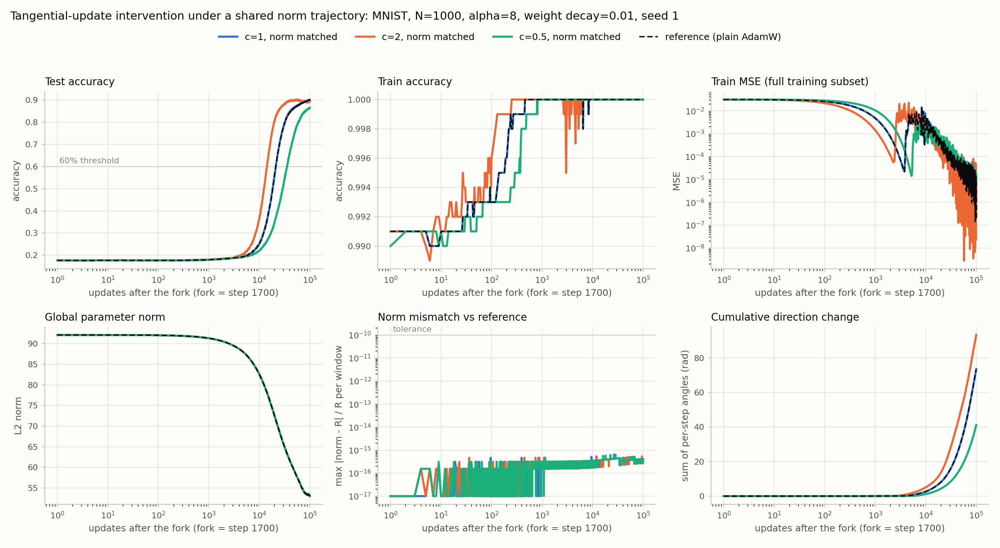

# 方向干预实验初步分析（seed 1，单 seed）

本文件由 `make_direction_figures.py` 根据 `summary.json` 自动生成，只描述这一个 seed；下面的比较是单 seed 观察，跨 seed 的汇总由 `summarize_seeds.py` 另行生成。

## 1. 设置

- 模型与数据：784→200→200→10 ReLU MLP，前 1000 个 MNIST 训练样本，alpha=8，AdamW lr=0.001，weight decay=0.01，batch=200，FP64。
- 分叉点：第 **1,700** 步（训练准确率首次 ≥ 99% 的评估步）。此时训练准确率 99.0%，训练 MSE 0.03097，测试准确率 17.7%，全局范数 92.10。
- 分叉后每组 100,000 步，各组使用同一批次序列，并在每一步把全局范数缩放到参考运行的 R_t。
- 参考运行的范数：分叉时 92.10，最小 53.01，末步 53.06。

## 2. 控制是否成立

| 检查 | 结果 | 判定 |
|---|---|---|
| 检查点恢复：参考切片对照不中断的原模型（前 200 步） | 参数最大绝对差 4.87e-14 | 通过 |
| c=1 重放：前 1000 步与参考运行的相对距离 | 最大 1.68e-14（容差 1e-09） | 通过 |
| 各组范数匹配：max \|范数 − R_t\| / R_t | c=1 6.3e-16；c=2 5.3e-16；c=0.5 6.4e-16 | 通过 |

c=1 在整个预算内与参考运行的相对距离最大为 5.60e-01，测试准确率最大相差 0.71 个百分点，训练 MSE 最大相差 3.15e-03。
c=1 与参考运行只差投影带来的舍入误差（约 1e-16），这个差距会在训练中被逐步放大；它给出本实验对微小扰动的敏感度，下文把它当作噪声底。

## 3. 泛化等待步数（自分叉点起）

| 组 | 测试 ≥60% | 测试 ≥70% | 测试 ≥80% | 测试 ≥85% | 测试 ≥90% | 验证 ≥60% | 末步测试准确率 |
|---|---:|---:|---:|---:|---:|---:|---:|
| ref | 21,200 | 25,100 | 32,000 | 42,500 | 93,800 | 21,100 | 90.1% |
| c=1 | 21,200 | 25,100 | 32,200 | 41,100 | 96,900 | 21,100 | 90.0% |
| c=2 | 14,200 | 16,300 | 19,700 | 23,900 | 43,600 | 14,200 | 89.3% |
| c=0.5 | 35,400 | 43,800 | 59,300 | 81,300 | 未达到 | 35,100 | 86.5% |

"未达到"表示在 100,000 步预算内没有达到该阈值，不能用预算上限代替。1,000 步之后评估间隔为 100 步。

## 4. 相同步数处的训练 MSE 与测试准确率

| 分叉后步数 | ref 训练 MSE | c=1 训练 MSE | c=2 训练 MSE | c=0.5 训练 MSE | ref 测试 | c=1 测试 | c=2 测试 | c=0.5 测试 |
|---:|---:|---:|---:|---:|---:|---:|---:|---:|
| 0 | 3.097e-02 | 3.097e-02 | 3.097e-02 | 3.097e-02 | 17.7% | 17.7% | 17.7% | 17.7% |
| 1,000 | 4.718e-03 | 4.718e-03 | 1.419e-03 | 1.035e-02 | 17.9% | 17.9% | 18.0% | 18.0% |
| 2,000 | 7.137e-04 | 7.137e-04 | 1.102e-04 | 2.938e-03 | 18.4% | 18.4% | 18.6% | 18.3% |
| 5,000 | 2.914e-03 | 2.914e-03 | 6.388e-03 | 2.020e-05 | 19.4% | 19.4% | 20.5% | 19.4% |
| 10,000 | 2.358e-03 | 1.536e-03 | 2.596e-03 | 1.949e-03 | 25.3% | 25.4% | 36.3% | 22.1% |
| 20,000 | 4.695e-04 | 4.015e-04 | 2.662e-04 | 5.964e-04 | 55.8% | 55.9% | 80.4% | 34.9% |
| 50,000 | 2.439e-05 | 5.193e-05 | 9.109e-07 | 5.944e-05 | 86.4% | 86.8% | 89.9% | 75.3% |
| 100,000 | 1.111e-05 | 8.018e-06 | 2.493e-07 | 9.973e-06 | 90.1% | 90.0% | 89.3% | 86.5% |

## 5. 实际方向变化

| 组 | 累计角度 (rad) | 相对参考运行 | AdamW 候选更新的平均切向范数（乘 c 之前） | 末步与参考参数的相对距离 | 首次出现非有限损失 |
|---|---:|---:|---:|---:|---:|
| ref | 73.434 | 1.00× | 4.455e-02 | 0.00e+00 | 无 |
| c=1 | 73.628 | 1.00× | 4.464e-02 | 5.60e-01 | 无 |
| c=2 | 93.321 | 1.27× | 2.916e-02 | 9.73e-01 | 无 |
| c=0.5 | 41.166 | 0.56× | 4.957e-02 | 7.76e-01 | 无 |

c 控制的是切向步幅，不是有效优化速度：累计角度不一定按 c 成比例变化，需要以上表的实测值为准。

## 6. 初步观察

- 参考运行在分叉后 21,200 步达到 60% 测试准确率；c=1 为 21,200。两者之差与 100 步的评估分辨率取较大者，作为噪声底：**100 步**。
- c=2：14,200 步（相差 -7,000 步），比参考运行**早** 33%，超过噪声底。累计角度为参考运行的 1.27 倍。
- c=0.5：35,400 步（相差 +14,200 步），比参考运行**晚** 67%，超过噪声底。累计角度为参考运行的 0.56 倍。
- 比较等待步数前先看第 4 节：若某组训练 MSE 明显高于参考运行，测试表现的差别可能来自训练拟合变差，而不是方向更新更快或更慢。

## 7. 结论边界

- 单 seed 结果不能区分干预效应与 seed 间波动；正式比较需要至少 3 个配对 seed。
- 匹配的是全局范数。各层范数（见诊断图下排）与内部表征并未匹配。
- 放大切向更新还会改变之后的梯度与 AdamW 状态；即使等待步数改变，也只能说明"相同全局范数轨迹不足以确定泛化时间"，不能说明方向优化是唯一或主要瓶颈。
- 测试集只按固定评估点记录，没有用于选择分叉点、c 或阈值。

图：[三组曲线、范数与范数误差](../../figures/direction/direction_curves_seed1.png)、[角度、与参考的距离、逐层范数](../../figures/direction/direction_diagnostics_seed1.png)。

