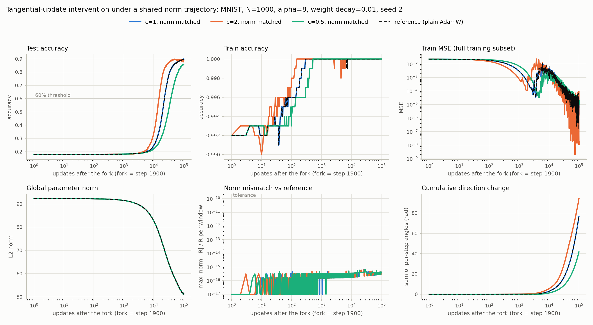

# 方向干预实验初步分析（seed 2，单 seed）

本文件由 `make_direction_figures.py` 根据 `summary.json` 自动生成，只描述这一个 seed；下面的比较是单 seed 观察，跨 seed 的汇总由 `summarize_seeds.py` 另行生成。

## 1. 设置

- 模型与数据：784→200→200→10 ReLU MLP，前 1000 个 MNIST 训练样本，alpha=8，AdamW lr=0.001，weight decay=0.01，batch=200，FP64。
- 分叉点：第 **1,900** 步（训练准确率首次 ≥ 99% 的评估步）。此时训练准确率 99.1%，训练 MSE 0.02261，测试准确率 17.9%，全局范数 92.26。
- 分叉后每组 100,000 步，各组使用同一批次序列，并在每一步把全局范数缩放到参考运行的 R_t。
- 参考运行的范数：分叉时 92.26，最小 51.03，末步 51.35。

## 2. 控制是否成立

| 检查 | 结果 | 判定 |
|---|---|---|
| 检查点恢复：参考切片对照不中断的原模型（前 200 步） | 参数最大绝对差 7.88e-15 | 通过 |
| c=1 重放：前 1000 步与参考运行的相对距离 | 最大 2.74e-11（容差 1e-09） | 通过 |
| 各组范数匹配：max \|范数 − R_t\| / R_t | c=1 6.3e-16；c=2 6.3e-16；c=0.5 6.4e-16 | 通过 |

c=1 在整个预算内与参考运行的相对距离最大为 6.11e-01，测试准确率最大相差 0.92 个百分点，训练 MSE 最大相差 5.15e-03。
c=1 与参考运行只差投影带来的舍入误差（约 1e-16），这个差距会在训练中被逐步放大；它给出本实验对微小扰动的敏感度，下文把它当作噪声底。

## 3. 泛化等待步数（自分叉点起）

| 组 | 测试 ≥60% | 测试 ≥70% | 测试 ≥80% | 测试 ≥85% | 测试 ≥90% | 验证 ≥60% | 末步测试准确率 |
|---|---:|---:|---:|---:|---:|---:|---:|
| ref | 22,800 | 26,900 | 34,100 | 44,700 | 未达到 | 22,700 | 89.7% |
| c=1 | 22,600 | 26,900 | 34,100 | 45,200 | 未达到 | 22,600 | 89.7% |
| c=2 | 14,900 | 17,100 | 21,000 | 26,600 | 未达到 | 14,900 | 88.6% |
| c=0.5 | 37,100 | 46,600 | 65,200 | 87,500 | 未达到 | 37,100 | 85.8% |

"未达到"表示在 100,000 步预算内没有达到该阈值，不能用预算上限代替。1,000 步之后评估间隔为 100 步。

## 4. 相同步数处的训练 MSE 与测试准确率

| 分叉后步数 | ref 训练 MSE | c=1 训练 MSE | c=2 训练 MSE | c=0.5 训练 MSE | ref 测试 | c=1 测试 | c=2 测试 | c=0.5 测试 |
|---:|---:|---:|---:|---:|---:|---:|---:|---:|
| 0 | 2.261e-02 | 2.261e-02 | 2.261e-02 | 2.261e-02 | 17.9% | 17.9% | 17.9% | 17.9% |
| 1,000 | 2.968e-03 | 2.968e-03 | 7.781e-04 | 7.006e-03 | 18.3% | 18.3% | 18.2% | 18.2% |
| 2,000 | 3.801e-04 | 3.801e-04 | 1.170e-03 | 1.779e-03 | 18.5% | 18.5% | 18.3% | 18.4% |
| 5,000 | 2.415e-03 | 2.482e-03 | 2.854e-03 | 1.034e-04 | 19.6% | 19.4% | 20.5% | 19.4% |
| 10,000 | 3.751e-03 | 1.327e-03 | 2.811e-03 | 2.947e-03 | 24.6% | 24.6% | 34.2% | 21.9% |
| 20,000 | 4.048e-04 | 5.218e-04 | 1.628e-04 | 8.642e-04 | 51.3% | 51.4% | 78.6% | 33.4% |
| 50,000 | 1.086e-04 | 1.460e-05 | 1.347e-05 | 8.604e-05 | 85.9% | 86.2% | 89.3% | 72.7% |
| 100,000 | 3.551e-05 | 1.112e-05 | 1.774e-08 | 1.196e-05 | 89.7% | 89.7% | 88.6% | 85.8% |

## 5. 实际方向变化

| 组 | 累计角度 (rad) | 相对参考运行 | AdamW 候选更新的平均切向范数（乘 c 之前） | 末步与参考参数的相对距离 | 首次出现非有限损失 |
|---|---:|---:|---:|---:|---:|
| ref | 76.397 | 1.00× | 4.560e-02 | 0.00e+00 | 无 |
| c=1 | 76.617 | 1.00× | 4.572e-02 | 6.11e-01 | 无 |
| c=2 | 94.199 | 1.23× | 2.920e-02 | 9.96e-01 | 无 |
| c=0.5 | 41.601 | 0.54× | 4.935e-02 | 7.64e-01 | 无 |

c 控制的是切向步幅，不是有效优化速度：累计角度不一定按 c 成比例变化，需要以上表的实测值为准。

## 6. 初步观察

- 参考运行在分叉后 22,800 步达到 60% 测试准确率；c=1 为 22,600。两者之差与 100 步的评估分辨率取较大者，作为噪声底：**200 步**。
- c=2：14,900 步（相差 -7,900 步），比参考运行**早** 35%，超过噪声底。累计角度为参考运行的 1.23 倍。
- c=0.5：37,100 步（相差 +14,300 步），比参考运行**晚** 63%，超过噪声底。累计角度为参考运行的 0.54 倍。
- 比较等待步数前先看第 4 节：若某组训练 MSE 明显高于参考运行，测试表现的差别可能来自训练拟合变差，而不是方向更新更快或更慢。

## 7. 结论边界

- 单 seed 结果不能区分干预效应与 seed 间波动；正式比较需要至少 3 个配对 seed。
- 匹配的是全局范数。各层范数（见诊断图下排）与内部表征并未匹配。
- 放大切向更新还会改变之后的梯度与 AdamW 状态；即使等待步数改变，也只能说明"相同全局范数轨迹不足以确定泛化时间"，不能说明方向优化是唯一或主要瓶颈。
- 测试集只按固定评估点记录，没有用于选择分叉点、c 或阈值。

图：[三组曲线、范数与范数误差](../../figures/direction/direction_curves_seed2.png)、[角度、与参考的距离、逐层范数](../../figures/direction/direction_diagnostics_seed2.png)。

