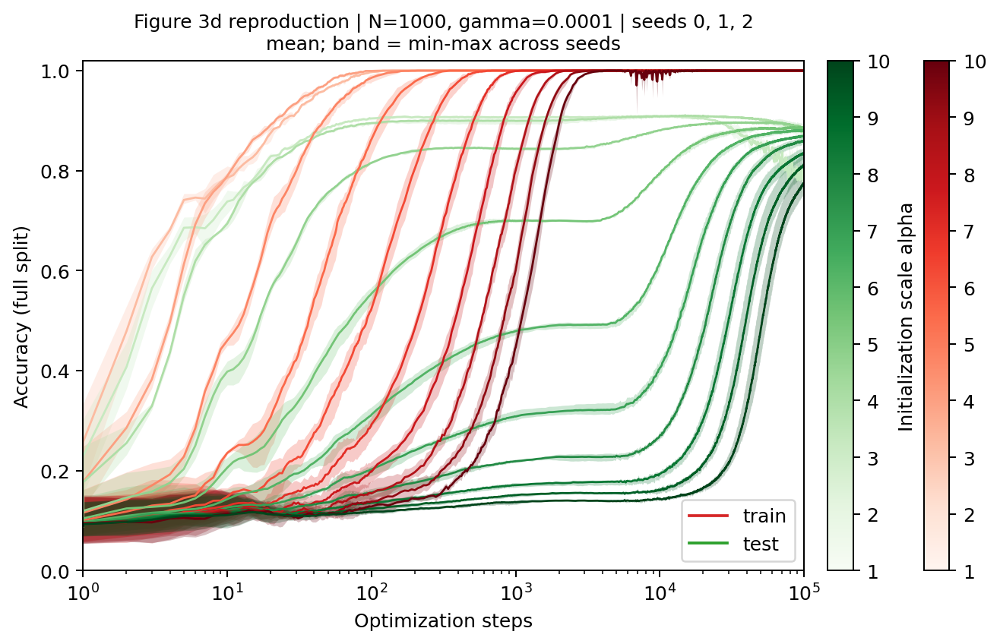
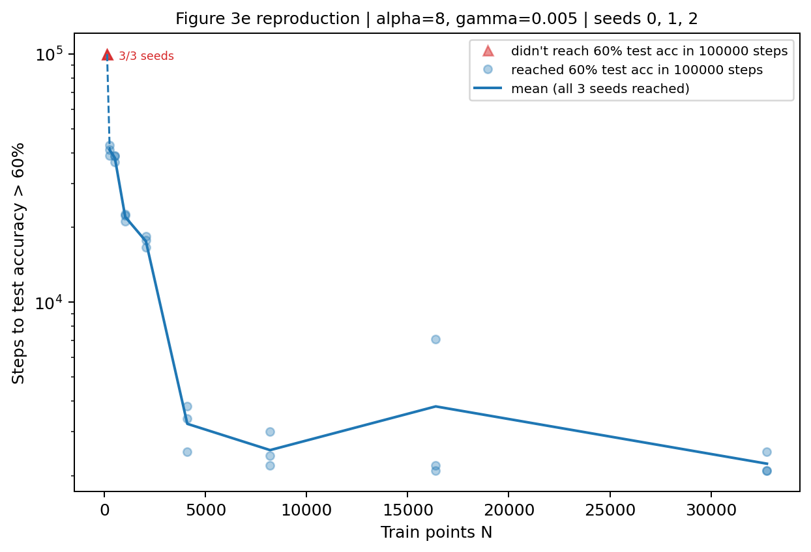

# MNIST Figure 3d–e：grokking 训练动力学

按论文原图设置完成 Figure 3d、3e，seeds **0、1、2**。每模型 100,000 次更新、1,181 个完整评估点。

| 实验 | 设置 | 每 seed 模型数 | 曲线行数 |
|---|---|---:|---:|
| `fig3d` | N=1000，γ=1e-4，alpha=1…10 | 10 | 35,430 |
| `fig3e` | alpha=8，γ=5e-3，N=128·2^k（128…32768），60% 阈值 | 9 | 31,887 |

[结果摘要](results/SUMMARY.md) · [原始曲线](results/) · [配置](configs/) · [验证记录](metadata/)





## 结果

**Figure 3d（N=1000，γ=1e-4）。**

- **alpha≤3**：测试准确率在 24 步内达到 60%，与训练集拟合（64–112 步）几乎同步。
- **alpha=4**：达到 60% 需 150 ± 10 步；之后在约 70% 停留，到 5,000–10,000 步才再次上升。
- **alpha≥5**：训练集在 447–2,933 步拟合，测试准确率达到 60% 却需 **9,533 ± 351**（alpha=5）至 **59,667 ± 5,380** 步（alpha=10）。等待步数随 alpha 单调增加。
- **alpha=10**：训练准确率在约 1 万步附近短暂下跌，三 seed 最低 91.2%–96.7%；论文原图同一位置也有下跌。第 100,000 步时测试准确率为 77.4% ± 3.0 个百分点，仍在上升。

以上排序、平台与跨 seed 带宽都与论文 3d 一致；alpha=5–10 达到 60% 的步数与论文读图相差 0%–4%（见下文"3d 与论文的定量对照"）。

γ=1e-4 时全局范数变化很小：

- alpha≥5 时，范数先降 3%–7% 再回升，最小值出现在测试准确率上升阶段。以 alpha=8 为例：达到 60% 在 35,367 步，范数由 93.6 降至约 88.0，最小值在 37,400–39,900 步。
- alpha=4 时范数几乎不变，降幅 <1%。
- alpha≤3 时范数单调上升，例如 alpha=1 由 11.7 升到 40.4。
- 末步范数仍随 alpha 递增（40.4→110.6），没有收敛到同一水平。

**Figure 3e（alpha=8，γ=5e-3）。**

- **N=128**：三个 seed 均未在预算内达到 60%（最高 46.4%），与论文原图的三个红色三角一致。
- **N=256→2048**：测试准确率达到 60% 所需步数由 **41,033 ± 1,955** 降至 **17,600 ± 917**。
- **N=4096**：骤降到 **3,233 ± 666**。论文原图同样在 N=2048 与 4096 之间骤降（读图 22,390 → 3,870）。
- **N≥4096**：约 2,200–3,800 步即达到 60%，测试准确率在训练集拟合（9,467–20,967 步）之前就已上升。

与论文的定量对照：

- 论文 3e 的点位已从 SVG 读出，见 `results/fig3e/paper_fig3e_digitized_comparison.csv`。
- 除 N=16384 外，本组均值为论文均值的 **0.73–0.84 倍**，即系统性快约 20%，曲线形状一致。
- N=16384 的均值受 seed 1 拖累：该模型在约 1,000 步时测试准确率回落到约 0.14，到 7,100 步才达到 60%；三 seed 中位数为 2,200 步。
- 系统性差异最可能来自 alpha 取值。论文未写 3e 的 alpha，本组取 8。下面的 alpha=9 对照把 N=256–2048 段的差距从约 20% 缩小到 0–4%。3d 对照又排除了实现本身的偏差（见下）。

**3e 的 alpha=9 对照。** 除 alpha 改为 9 外，设置与 `fig3e` 完全相同：N 网格、γ、批次随机流（序号 j=0）和 seeds 0–2 都一样。因此每个 seed 与 alpha=8 运行共享基础初始化和批次顺序，可以逐 seed 配对比较。

| N | alpha=8 均值 | alpha=9 均值（各 seed） | 论文读图均值 | alpha=8/论文 | alpha=9/论文 |
|---:|---:|---|---:|---:|---:|
| 128 | 0/3 达到 | 0/3 达到（末步 37.6%–40.7%） | 未达到 ×3 | — | — |
| 256 | 41,033 | 51,233（54,200; 47,300; 52,200） | 49,180 | 0.83 | **1.04** |
| 512 | 38,133 | 47,967（48,700; 46,200; 49,000） | 45,980 | 0.83 | **1.04** |
| 1,024 | 22,067 | 27,600（27,900; 26,500; 28,400） | 26,860 | 0.82 | **1.03** |
| 2,048 | 17,600 | 22,467（23,800; 21,000; 22,600） | 22,390 | 0.79 | **1.00** |
| 4,096 | 3,233 | 6,333（5,200; 10,200; 3,600） | 3,870 | 0.84 | 1.64 |
| 8,192 | 2,533 | 5,033（3,500; 8,300; 3,300） | 3,240 | 0.78 | 1.55 |
| 16,384 | 3,800 | 5,433（2,900; 10,400; 3,000） | 3,100 | 1.23 | 1.75 |
| 32,768 | 2,233 | 3,267（3,000; 3,700; 3,100） | 3,070 | 0.73 | 1.06 |

- **N=256–2048**：等待步数长，跨 seed 波动小，是区分 alpha 的主要依据。同一 seed 下 alpha=9 与 alpha=8 的步数比为 1.25–1.28。3d 中 alpha=9 与 alpha=8 的比为 46,167/35,367 ≈ 1.31，两者一致。
- **N≥4096**：只需几千步，噪声相对较大。alpha=9 的均值主要被 seed 1 拉高（N=4096、8192、16384 分别为 10,200、8,300、10,400 步）；三 seed 中位数为 5,200、3,500、3,000、3,100 步，除 N=4096 外与论文接近。这一段不足以区分 alpha。
- 结论：论文 3e 很可能用 alpha=9，与附录 C 的 MNIST 设置相同。前 N 个样本与随机子集之差、随机状态之差，不足以解释 N=256–2048 段一致的约 20% 差距。
- alpha=9 对照的数据与图只保存在本机 `generated/fig3e_alpha9/`，未纳入 Git，也不在 `manifest_sha256.json` 中；`results/`、`figures/` 中的 3e 仍为 alpha=8。

**3d 与论文的定量对照。** 从 arXiv v2 的 3d SVG（`mnist-grokking-curve-many.svg`）提取各 alpha 的测试准确率曲线路径，按坐标轴刻度换算，取首次 ≥60% 的步数。论文曲线每 100 步记录一次，读图值取整到 100 步。

| alpha | 论文读图 | 本组均值 | 本组/论文 |
|---:|---:|---:|---:|
| 5 | 9,500 | 9,533 | 1.00 |
| 6 | 16,400 | 17,067 | 1.04 |
| 7 | 25,400 | 25,200 | 0.99 |
| 8 | 34,900 | 35,367 | 1.01 |
| 9 | 45,400 | 46,167 | 1.02 |
| 10 | 59,500 | 59,667 | 1.00 |

3d 的设置在论文图中完整给出，本组结果与之相差 0%–4%，说明训练循环、初始化缩放与评估口径与论文一致。alpha≤4 在 100 步内达到 60%，低于论文的记录间隔，不作对比。

两组结果都支持论文的定性结论：初始化范数越大，泛化越晚（3d）；训练样本越多，泛化越早（3e）。本组未检验备择假设，也不能证明范数收缩是延迟泛化的唯一原因。3d 中达到 60% 时范数只下降了几个百分点，这一点在解释 LU 机制时需注意。

## 协议

| 项目 | 设置 |
|---|---|
| 数据 | MNIST，固定前 N 个训练样本；测试集 10,000 个样本 |
| 网络 | 784→200→200→10，隐藏层 ReLU，含 bias；官方 Kaiming uniform 初始化后全部参数乘 alpha |
| 训练损失 | one-hot 标签的 element-mean MSE（`nn.MSELoss()`） |
| 优化器 | AdamW，lr=0.001，weight_decay=γ（fig3d 1e-4，fig3e 5e-3），其余为默认值 |
| 预算 | 每模型 100,000 次更新，batch=200，每 epoch 重新打乱，保留末尾小 batch |
| 约束 | 无范数约束，范数随 weight decay 与训练自由变化 |
| 精度 | FP64，关闭 TF32，不使用混合精度 |

同一 seed、同一实验内的模型共享基础初始化（再按 alpha 缩放）。每个模型使用独立的批次随机流 `seed*1000000 + 10*N + j`，j 为 alpha 在该实验 alpha 列表中的序号：fig3d 为 alpha−1，fig3e 为 0。跨 seed 时改变初始化和批次顺序，不改变训练样本成员。

### 设置来源

依据论文 PDF（ICLR 2023 版，第 5 页 Figure 3、附录 A）与 arXiv v2 的图 SVG，二者一致：

| 设置 | 来源 |
|---|---|
| 3d：N=1000、γ=1e-4、alpha=1…10 | 3d 图标题 "MNIST Grokking With Varying α, 1000 Train Points, γ=1e-4" 与色标 |
| 3e：γ≈5e-3、60% 阈值、1e5 步预算 | 3e 图标题、纵轴 "Steps to Test Accuracy > 60%"、图例 "didn't reach 60% test acc in 10^5 steps" |
| 3e：N=128·2^k（k=0…8） | 由 SVG 标记横坐标读出，每个 N 约 3 次运行 |
| batch=200、网络与初始化 | 附录 A 与官方 notebook |
| **3e 的 alpha=8** | **本组假设**：论文未写，取官方 notebook 默认值。附录 C 的 MNIST 实验用 alpha=9；alpha=9 对照与论文 3e 更接近（见"结果"） |
| 前 N 个样本 | 官方 notebook 做法；论文正文写 random subset |

训练循环依据[官方仓库](https://github.com/KindXiaoming/Omnigrok)固定 commit `3a0a57346230a7255e5390fcd565812d00f1a281` 的 [grokking notebook](https://github.com/KindXiaoming/Omnigrok/blob/3a0a57346230a7255e5390fcd565812d00f1a281/mnist/grokking/mnist-grokking.ipynb)。

### 实现与验证

`run_dynamics.py --experiment {fig3d,fig3e}` 是本组据官方协议整理的实现：

- 数据缓存在 GPU 上，用批量矩阵乘法并行训练一个实验的全部独立模型。
- 各模型的参数、梯度和 AdamW 状态相互独立。
- loss 对模型求和，避免梯度额外除以模型数。
- batch 不足 200 时，用 mask 只对真实样本求均值，与官方 `nn.MSELoss()` 一致。

`--validate` 在该实验的 γ 下，用官方 notebook 循环（seed 0、同一初始化、同一 DataLoader 批次）对照 3 个代表模型，各跑 50 步。验证失败会阻止训练。

| 实验 | 对照模型 (N, alpha) | 参数最大绝对差 | 完整评估指标差 |
|---|---|---:|---:|
| fig3d | (1000,1)、(1000,5)、(1000,10) | 0.0 | 1.1e-13 |
| fig3e | (128,8)、(1024,8)、(32768,8) | 1.1e-16 | 5.7e-14 |

图像转换均逐位一致。验证固定使用 notebook 的 seed 0，属于方法检查，每次训练前都重跑一次。六次训练使用同一份训练代码（SHA256 `8e50e308…`，见 `metadata/provenance.json`）。

与官方 notebook 的其他差异：

- 评估从约 150 个记录点加密为 1,181 个（0–99 步逐步，100–990 步每 10 步，此后每 100 步），均为完整评估。
- 每一步都记录逐层范数。
- 批次随机流显式设种子，不复现作者未公开的随机状态。
- 运行环境为 Windows + RTX 5060 + PyTorch 2.8，不同于 `mnist_landscape` 的 Linux 环境。

### 指标口径

- `train_accuracy`/`test_accuracy`：完整训练子集（N 个样本）与完整测试集的准确率，0–1 比例。
- `train_loss`/`test_loss`：十个输出平方误差之和的样本均值，**等于训练用 element-mean MSE 的十倍**，与官方 `compute_loss` 及 `mnist_landscape` 口径相同。
- `global_norm`、`norm_layer1..3`：全部参数（含 bias）与各层（weight+bias）的 L2 范数，取自同一评估步。
- `fit_step`：训练准确率首次 ≥ 99% 的计划评估步。
- `steps_to_test_XX`：测试准确率首次 ≥ XX% 的计划评估步。
  - 3e 的主指标为 `steps_to_test_60`，表中另报 50%、70%、80%、90%。
  - 预算内未达到时为空；汇总时不用预算代替，而是给出达到的 seed 数（`_reached`）。
  - 1,000 步之后的分辨率为 100 步。
- 汇总中的 `*_std` 是跨 seed 样本标准差（ddof=1），不是标准误或置信区间。阈值步数只在三个 seed 均达到时才给出均值与 SD。

## 文件

| 路径 | 用途 |
|---|---|
| `code/run_dynamics.py` | GPU 训练、与官方循环的验证、拟合与末步检查点；`--experiment` 选择实验 |
| `code/make_figures.py` | 单 seed QA、导出 `curves.csv` 与单 seed 图 |
| `code/collect_results.py` | 收集三次运行的曲线、配置与 QA |
| `code/aggregate_seeds.py` | CPU 重算统计并绘图；`--experiment` 选择实验 |
| `code/verify_results.py` | 只用标准库：检查哈希，并对两个实验独立复算统计 |
| `results/<实验>/` | 全部曲线、逐 seed 时间表、按条件均值/SD；`fig3e/` 另含论文 3e 读图对照 |
| `figures/<实验>/` | 三 seed 汇总 PNG/PDF、逐 seed 测试曲线或范数 PNG |
| `configs/<实验>/` | 各 seed 的完整配置（含 `figure_source`） |
| `metadata/<实验>/` | 方法验证、逐 seed QA 与汇总 QA |
| `metadata/*.json` | 环境、包版本、来源、训练代码哈希、训练耗时 |
| `manifest_sha256.json` | 本材料各文件的相对路径与 SHA256 |

以下内容未上传：

- MNIST 数据；
- 各次运行的 `history.npz`（逐步范数，约 18–20 MB/次）；
- 检查点（约 84–93 MB/次）；
- 日志与单 seed 图。

已提交的图可以直接从 Git 中的数据重画。逐步范数与检查点需从本机 `generated/<实验>/seed*/` 取得，或重新训练。

## 运行

先进入本目录。分析无需 GPU 或 PyTorch；训练需 NVIDIA CUDA GPU。依赖清单记录的是 Windows 11、Python 3.13 环境。`torch 2.5.1+cu124` 不支持 RTX 50 系列（sm_120），因此训练依赖使用 cu128。

### 校验与重绘现有结果

```bash
python code/verify_results.py
```

```bash
python -m pip install -r requirements-analysis.txt
```

```bash
python code/aggregate_seeds.py --experiment fig3d
```

- 第一条只用标准库：核查哈希与曲线完整性，并对两个实验独立复算阈值步数与统计表。
- 第二条安装重绘所需依赖。
- 第三条从已提交的 CSV 和配置生成全套表、QA、PNG/PDF，写入 `generated/summary/fig3d/`，不覆盖现有产物。把 `fig3d` 换成 `fig3e` 即可处理 3e。

`generated/` 不纳入 Git。

### 从头训练

```bash
python -m pip install -r requirements-train.txt
```

```bash
python code/run_dynamics.py --experiment fig3d --root generated/fig3d/seed0 --data-root data --seed 0 --validate
```

```bash
python code/run_dynamics.py --experiment fig3d --root generated/fig3d/seed0 --data-root data --seed 0
```

```bash
python code/make_figures.py --root generated/fig3d/seed0
```

- 换实验或 seed 时，修改 `--experiment`、`--seed` 与 `--root`。
- 每个根目录都先运行 `--validate`；验证失败会阻止训练。
- torchvision 会自动下载 MNIST。已有数据时，`--data-root` 指向包含 `MNIST/raw/` 的上级目录。
- 不支持断点续训；中断后用新目录重跑。

三个 seed 跑完后，汇总：

```bash
python code/collect_results.py --runs generated/fig3d/seed0 generated/fig3d/seed1 generated/fig3d/seed2 --output generated/fig3d/collected
```

```bash
python code/aggregate_seeds.py --experiment fig3d --input generated/fig3d/collected/all_seeds_curves.csv --configs-dir generated/fig3d/collected/configs --output generated/fig3d/new_summary
```

参考环境：RTX 5060 8 GB，Python 3.13.14，PyTorch 2.8.0+cu128。各 seed 依次运行，训练进程计时如下：

| 实验 | seed 0 | seed 1 | seed 2 |
|---|---:|---:|---:|
| fig3d | 25.2 分钟 | 25.5 分钟 | 24.2 分钟 |
| fig3e | 25.3 分钟 | 24.2 分钟 | 23.9 分钟 |

前置测速时，10 个模型 FP64 的显存峰值约 0.5 GB。这些耗时不保证适用于其他机器。

## 后续交接

1. Figure 3d–e 已按论文设置完成，可直接用于 check-in。引用 3e 时需注明 alpha=8 是假设，且本组结果比论文快约 20%；alpha=9 对照在 N=256–2048 段与论文相差 0–4%，可作为差距来源的依据。
2. 3e 的 N=16384 受单个 seed 不稳定影响。若需收窄大 N 段的不确定度，应增加 seed；同一 seed 内各 N 共享初始化，增加 N 点不能替代增加 seed。
3. 备择假设实验（[实验思路](../../../Grokking实验思路.md) 中的切向更新干预）可从 `generated/fig3d/seed*/checkpoints/fit_N01000_alpha8.pt` 分叉：
   - 该文件保存训练准确率首次 ≥ 99% 时的模型参数、AdamW `exp_avg`/`exp_avg_sq`/`step`，以及批次采样器状态。
   - 其他 alpha 的同名检查点也可用。
   - 参考范数轨迹 R_t 可取自 `history.npz` 中逐步记录的 `layer_norms_squared`。
   - 分叉前需先确认 c=1 重放组能逐步重现参考运行。
4. 若备择假设需要 feature norm、表征相似度等量，这里没有记录，应先与假设负责人明确干预方式与预测。

100,000 步是固定预算，部分模型在预算内未达到高阈值。三 seed 结果只用于定性复现，不作机制唯一性结论。
