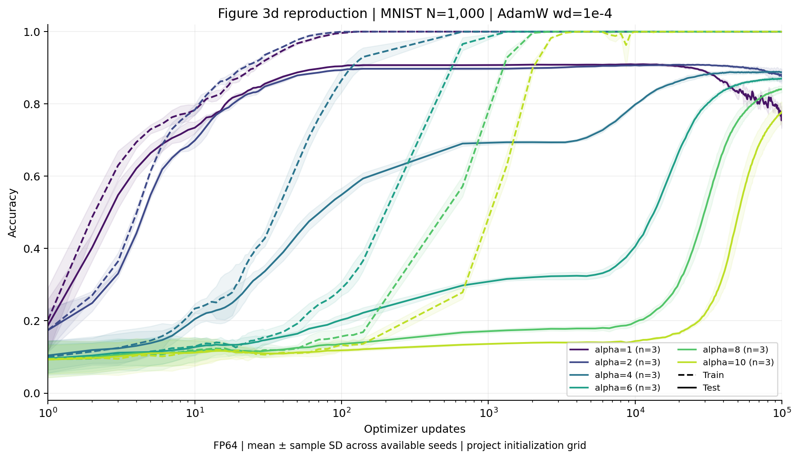
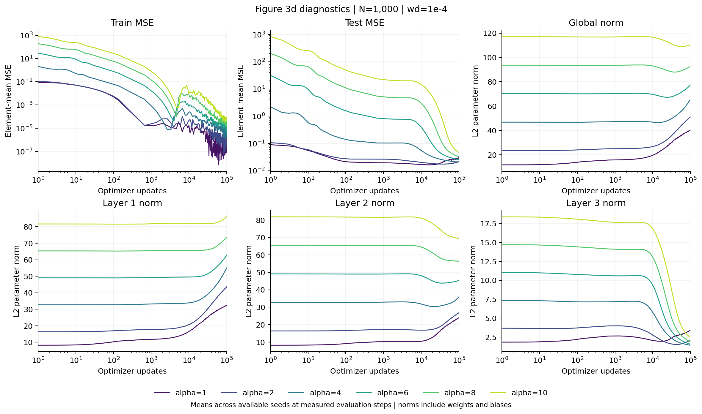
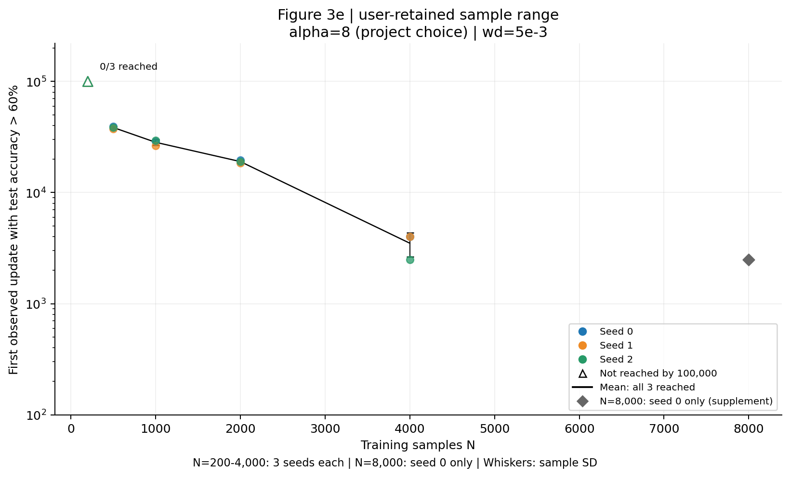
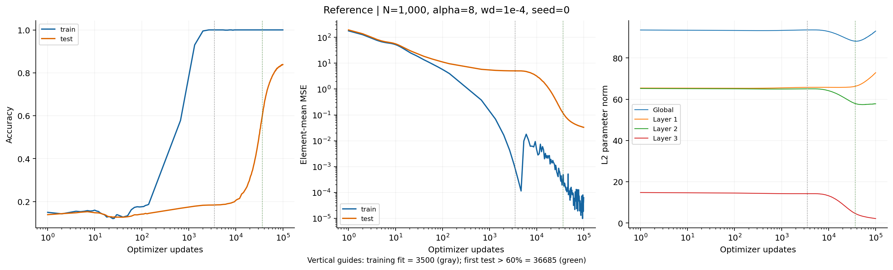

# Part C 本地复现结果：Figure 3d-e

生成时间：2026-10-27T14:55:14-07:00。

已按用户修订范围完成 34 条保留运行，每条 100000 次更新，合计 3,400,000 次正式更新。Figure 3d 为6个alpha×3 seeds；Figure 3e主实验为N=200/500/1000/2000/4000×3 seeds，另保留此前已完成的N=8000 seed0作单seed补充。所有训练由本机RTX 4060 Laptop GPU计算，成果供本地审阅。

用户在侧对话明确要求：“取消后续排队的N=8000、16000、30000任务，只保留已经进行的这一条跑完。” 因此原42条计划中的8条已取消；N=8000 seed1的22000步部分产物保留但不计入结果，取消不视为阈值右删失。本报告完成状态针对用户保留的34条，未声称完成原42条全部网格。来源见metadata/user_cancellation.json和approved_scope.json。

## 复现级别与配置

本结果是**有明确配置差异的定性复现**。3d 的 N=1000、weight decay=1e-4，以及 3e 的 weight decay=5e-3、100000 步预算和 >60% 图轴均按论文。3e 的 alpha=8、N 网格、种子和评估时点为预先固定的项目选择；官方公开 notebook 及其 main 历史没有提供完整的 3e 扫描协议。不能称为原论文逐点精确复现。

网络为 784→200→200→10 ReLU MLP，含偏置；one-hot element-mean MSE；AdamW lr=.001，batch=200，FP64，自由训练，无范数投影；训练子集固定前 N 个。详见 README 和 metadata/provenance.json。测试集仅按固定时点评估，不用于选择 seed、参数或拟合检查点。

## Figure 3d：初始化尺度

| alpha | 达到 60% / 3 | 拟合早于 t60 / 3 | t60 均值 ± 样本 SD（步） | 最终测试准确率均值 ± SD |
| ---: | ---: | ---: | ---: | ---: |
| 1 | 3/3 | 0/3 | 4.33 ± 0.58 | 76.59% ± 2.87 个百分点 |
| 2 | 3/3 | 0/3 | 6.00 ± 0.00 | 87.91% ± 1.70 个百分点 |
| 4 | 3/3 | 0/3 | 491.33 ± 304.26 | 88.77% ± 0.30 个百分点 |
| 6 | 3/3 | 3/3 | 17,342.00 ± 1,155.28 | 87.04% ± 0.53 个百分点 |
| 8 | 3/3 | 3/3 | 35,351.00 ± 2,310.56 | 84.10% ± 0.94 个百分点 |
| 10 | 3/3 | 3/3 | 59,363.00 ± 5,209.44 | 77.87% ± 2.73 个百分点 |

三个 seed 中 alpha=8 的 t60 均晚于 alpha=1。 配对 t60 差值（alpha8−alpha1，步）：seed 0: 36680, seed 1: 32679, seed 2: 36681。 alpha=1 的末步测试准确率比各自观测峰值下降 12.22–17.41 个百分点，完整轨迹不一定单调。峰值仅作事后描述，未用于选检查点或调整配置。 alpha=4 在训练拟合时测试准确率已为 69.08%–69.87%，之后仍进一步改善；因此 t60 不是对所有后期改善的完整概括。

这里的 t60 是辅助量，不替代原图完整训练/测试曲线；最终准确率也不等同于首次达到时间。图中带为三个 seed 间样本标准差，非置信区间；所有单 seed 曲线保存在 figure3d_by_seed.png。训练拟合时刻使用训练准确率>=99% 且 element-mean MSE<=.001 的项目定义，不能与 t60 的 60% 测试阈值直接看成同一难度标准。

补充图在共同的实际评估时点计算三个seed均值，分别展示训练/测试MSE、全局和三层含偏置范数，不对缺失时点插值。每条原始逐步范数仍保存在runs目录。

## Figure 3e：数据量与首次泛化时间

| N | seed 0 的 t60 | seed 1 的 t60 | seed 2 的 t60 | 达到 / 保留seed | 均值 ± 样本 SD |
| ---: | ---: | ---: | ---: | ---: | ---: |
| 200 | >100000（未达到） | >100000（未达到） | >100000（未达到） | 0/3 | 有删失，不报普通均值 |
| 500 | 39,500 | 37,500 | 38,500 | 3/3 | 38,500.00 ± 1,000.00 |
| 1,000 | 29,000 | 26,500 | 29,500 | 3/3 | 28,333.33 ± 1,607.28 |
| 2,000 | 19,500 | 18,500 | 19,000 | 3/3 | 19,000.00 ± 500.00 |
| 4,000 | 4,000 | 4,000 | 2,500 | 3/3 | 3,500.00 ± 866.03 |
| 8,000（补充） | 2,500 | 用户取消 | 用户取消 | 1/1 | 单seed补充，不报均值/SD |

主实验中，seed 0：4/5 个N达到阈值，已达到的 N 点间有 0 次随 N 增大而 t60 反增；seed 1：4/5 个N达到阈值，已达到的 N 点间有 0 次随 N 增大而 t60 反增；seed 2：4/5 个N达到阈值，已达到的 N 点间有 0 次随 N 增大而 t60 反增。N=8000单seed不纳入三seed趋势统计。这只描述已观测点，不将删失时间排序成真实达到时间。

| N | 达到训练拟合 / 保留seed | 拟合step中位数或单seed值 | t60−fit：seed 0 / 1 / 2（步） |
| ---: | ---: | ---: | --- |
| 200 | 3/3 | 1,000 | 未越阈 / 未越阈 / 未越阈 |
| 500 | 3/3 | 2,000 | 37,500 / 35,500 / 36,500 |
| 1,000 | 3/3 | 3,500 | 25,500 / 23,000 / 26,000 |
| 2,000 | 3/3 | 15,000 | 4,500 / 3,000 / 4,000 |
| 4,000 | 3/3 | 18,500 | -14,500 / -28,500 / -13,000 |
| 8,000（补充） | 1/1 | 26,000（单seed） | -23,500 / 用户取消 / 用户取消 |

上表的时间差使用已记录的训练拟合定义与测试60%阈值，两者难度不同。正值表示达到训练拟合后才观测到测试越阈，负值表示测试先越阈；这是操作性时间差，不将训练拟合与测试阈值混为同一事件。

每500步完整评估测试集，并额外保留0/10/50/100/200的早期评估。t60是首次**观测到**准确率严格大于60%的更新数，不作插值。预算内未达到是右删失，不填成真实100000；普通均值只在三个seed均达到时计算。N=8000仅作单seed补充，不给均值/SD。用户取消、运行错误与阈值未达到分开记录；本报告保留的34条都完成全部预算。

## 可交接参考训练

reference：`fig3d_n1000_a8_s0`。训练拟合检查点 step=3500；测试首次 >60% 的评估 step=36685；最终训练准确率 100.00%，最终测试准确率 83.86%。

范数从 93.539183 开始，最小值 88.107937 位于 step=38800，最后为 93.017128。逐步轨迹不应被概括成单调范数收缩；全局和各层尺度分配也需区分。

参考运行训练拟合时的element-mean MSE为0.00084064，末步为6.32094e-05。达到训练拟合定义后，MSE与范数仍继续变化，不能将拟合时刻当作训练动力学终点。

`runs/fig3d_n1000_a8_s0/norms.npy` 含 100001×4 个 FP64 数值（global、三层），t 行对应 t 次更新之后。拟合 checkpoint 恢复后的 200 步范数与原始未来轨迹最大绝对差 0。另有跨进程 smoke 对照，模型、优化器与 sampler 状态完全一致。

给 D：使用同一 run 的 fit.pt、resolved_config.json、train_indices.npy、norms.npy；检查点包含模型、AdamW、随机状态、当前 permutation/cursor。下一次更新应匹配 R[k+1]。本阶段仅验证正常续训恢复，不宣称已完成 c=1 投影重放或方向干预。

## 验证与可追溯性

- 50 步同批次更新对照参数最大差 0；输入转换与官方 CPU FP64 ToTensor 逐位一致。
- 连续 200 步与跨进程 100+100 步恢复的参数、优化器、sampler、范数均一致；四进程独立运行也通过相同对照。
- 34条保留配置与用户修订后的manifest一致；每条范数100001行，有限且分层平方和一致；指标/分类计数/loss单位检查通过；阈值由原始CSV独立重算。
- 136 个保存检查点通过 CPU 审计：模型范数与轨迹的最大绝对差 2.84e-14；优化器步数、sampler位置、训练索引与训练源码hash一致。
- 原始日志、命令、配置、数据索引、环境、检查点都在 runs 下；完整工作及线上操作记录在工作区 log.md。轻量结果与图可从这些文件重新生成。
- 汇总采用样本 SD（ddof=1）；三个 seed 无法支撑强普遍性或唯一机制结论。数据成员跨 seed 相同，变异主要来自初始化和训练批次。

运行管理曾因Windows状态文件临时共享占用导致调度器退出。调度写入已增加有界重试，并通过真实文件锁回归验证。退出码证据中，0条来自直接记录，27条由调度成功日志还原为0，7条历史退出码未留存；不为缺失记录补造数值。全部34条保留模型和指标的完整性均已独立审计。侧对话取消名单由调度器在加载清单及每次启动前检查。详见metadata/process_outcomes.json与工作日志。

elapsed_seconds为各训练进程的perf_counter墙钟计时，包含等待或暂停间隔，不能等同于GPU有效计算时间；并发时也不能将各进程耗时相加当作项目总墙钟时间。本次N=4000 seed0的计时跨夜，原始值如实保留。

## 结论边界与差异

原图的平滑、随机状态、完整扫描设置和测试评估间隔未全部公开。当前采用显式 seeds、固定全量评估、独立训练 RNG、额外末步评估和可恢复 sampler；这些改变均已记录。论文文字中的随机训练子集与 notebook 的前 N 个样本不完全相同，当前遵循后者。

曲线支持或不支持的趋势应结合上表逐 seed 检查，不根据图片外观预设成功。本实验没有改变方向更新幅度，因此不能据此证明/否定本组切向更新备择假设，也不能证明范数是唯一原因。

## 审阅入口

- `results/runs.csv`：34条保留运行的逐运行结果。
- `results/summary.csv`：按条件汇总，保留达到数和删失数。
- `results/metrics.csv`：全部实际评估点。
- `results/qa.json`：独立数据验收。
- `results/HANDOFF.md` 与 `results/ABSTRACT_A.txt`：A/B/D 的本地交接说明和摘要。
- `figures/`：3d、3e、逐 seed 和参考诊断 PNG/PDF。
- `metadata/validation/`、`metadata/concurrency4/`、`metadata/reference_checkpoint_replay/verification.json`：验证证据。
- `README.md`：环境和运行/恢复/重绘命令。

原图对照与可能原因见[INTERPRETATION_ZH.md](INTERPRETATION_ZH.md)，可粘贴段落见[CHECKIN_SUMMARY_ZH.md](CHECKIN_SUMMARY_ZH.md)。按用户新授权同步GitHub；完整检查点、范数和运行日志下载及校验方法见[PUBLICATION.md](../PUBLICATION.md)。
