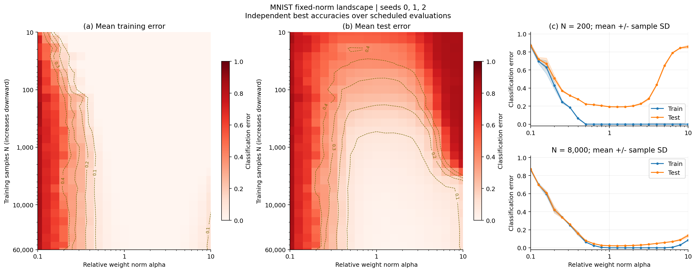

# MNIST Figure 3a–c：固定范数景观

已完成 seeds **0、1、2**：每 seed 630 个条件，每条件 10,000 次更新，共 1,890 条结果。

[结果摘要](results/SUMMARY.md) · [原始数据](results/all_seeds_results.csv) · [配置](configs/) · [验证记录](metadata/)



## 结果

N=200 时，alpha 从 1 增加到 10，训练误差均为 0，paper-style 测试误差从 **19.28% ± 0.23 个百分点**升到 **85.87% ± 1.89 个百分点**。N=8000 时对应为 **2.33% ± 0.08** 和 **13.65% ± 1.86 个百分点**。三个 seed 的配对差异方向一致；训练损失选定检查点的完整测试评估也得到相同方向。

这支持 Figure 3a–c 的定性规律：大范数模型可以拟合小训练集，却泛化很差；增加样本量能缓解这一现象。尚未复现 Figure 3d–e 的时间动力学，未检验本组备择假设，也不能证明范数是唯一因果因素。部分网格波动较大，不能认为全部数值稳定或与原论文逐点一致。

## 协议

| 项目 | 设置 |
|---|---|
| 数据 | MNIST，固定前 N 个训练样本；测试集 10,000 个样本 |
| 网络 | 784→200→200→10，隐藏层 ReLU，含 bias |
| 训练损失 | one-hot 标签的 element-mean MSE |
| 优化器 | AdamW，lr=0.001，weight_decay=0，foreach=False |
| 预算 | 每条件 10,000 次更新，batch=100，保留末尾小 batch |
| 约束 | 每步投影到初始化缩放后的全局 L2 范数，含 weight 和 bias |
| alpha | 10**linspace(-1,1,21)，0.1–10，相对基础初始化的倍率 |
| 网格 | 官方 28 个 N ×21 alpha，另加精确 N=200、8000 ×21 alpha |
| 精度 | FP32，关闭 TF32，不使用混合精度 |

不同 alpha 共享基础初始化、训练批次和评估抽样；不同 N 也共享基础初始化。训练和评估随机数流分离。跨 seed 改变初始化、批次和评估抽样，不改变训练样本成员。检查到的最大范数相对误差 2.38e-7。

### 源码与实现差异

依据[官方仓库](https://github.com/KindXiaoming/Omnigrok)的固定 commit `3a0a57346230a7255e5390fcd565812d00f1a281`：

- [训练 notebook](https://github.com/KindXiaoming/Omnigrok/blob/3a0a57346230a7255e5390fcd565812d00f1a281/mnist/landscape/mnist-landscape.ipynb)
- [绘图 notebook](https://github.com/KindXiaoming/Omnigrok/blob/3a0a57346230a7255e5390fcd565812d00f1a281/mnist/landscape/plot-mnist-landscape.ipynb)

`run_landscape.py` 是本组据官方协议整理的实现，修正设备标签处理等运行问题，显式设置 seed，缓存 GPU 数据，并以批量矩阵乘法并行 21 个独立模型。各模型参数、梯度、Adam 状态和投影独立；loss 对模型求和，避免梯度额外除以 21。

`metadata/validation.json` 记录输入转换逐位一致及独立串行模型 20 步数值对照，最大参数绝对差约 5.14e-5。批量计算不保证与串行计算逐位相同，也不保证与作者未公开随机状态相同。官方 notebook 未显式循环三个 seed；本组主动运行三次。

原绘图使用平滑、插值与硬编码截面索引，原 N 网格没有精确 200、8000。本组独立补算这两个截面；汇总热图仅画原网格，不平滑，纵轴 N 向下增加。对照目标是定性景观，不称为作者原始数值的逐点复刻。

### 指标口径

- `paper_best_*_accuracy`：在 step 1、51、…、9951 分别取最高采样准确率；error=1−accuracy。各指标可能来自不同检查点。测试极值仅作描述，没有据此选模型。
- `paper_min_*_loss`：上述计划中各自最小采样损失。
- `selected_full_*`：按采样训练损失选检查点，再完整评估 N 个训练与 10,000 个测试样本。
- `final_full_*`：第 10,000 步同一模型的完整评估，末步不混入 paper-style 极值。
- 每次计划评估为训练/测试 accuracy/loss 分别独立抽取至多 2,000 个样本。
- CSV accuracy/error 均为 0–1 比例。报告 loss 是十个输出平方误差之和的样本均值，**等于训练用 element-mean MSE 的十倍**。
- 汇总 `*_std` 是跨 seed 样本标准差（ddof=1），不是标准误或置信区间；配对比较先在每个 seed 内作差再汇总。

## 文件

| 路径 | 用途 |
|---|---|
| `code/run_landscape.py` | GPU 训练、独立验证、分组恢复 |
| `code/make_figures.py` | 新训练的单 seed 绘图与 QA |
| `code/collect_results.py` | 收集三次新运行的 CSV 和配置 |
| `code/aggregate_seeds.py` | CPU 重算统计并绘图 |
| `code/verify_results.py` | 仅标准库：哈希检查及独立复算统计 |
| `results/` | 1,890 行原始表、630 行均值/SD、截面与配对对比 |
| `figures/` | 两种评估口径合成 PNG/PDF，逐 seed 与 SD PNG |
| `configs/`、`metadata/` | 完整配置、环境、方法验证、逐 seed 与汇总 QA |
| `manifest_sha256.json` | 本材料的相对路径 SHA256 |

未上传 MNIST、约 6 GB 模型检查点、临时归档、日志、服务器调度脚本及重复单 seed 图。完整逐步历史在原服务器检查点内；从 Git 可直接重画已提交图，逐步参数分析需另取检查点或重跑。

## 运行

先进入本目录。建议新建 Python 3.12 虚拟环境；分析无需 GPU/PyTorch，训练需 NVIDIA CUDA GPU。依赖清单记录当时 Linux 环境版本。

### 校验与重绘现有结果

```bash
python code/verify_results.py
python -m pip install -r requirements-analysis.txt
python code/aggregate_seeds.py --output generated/summary
```

第一条仅用标准库，核查哈希、数据完整性及统计表。最后一条从已提交 CSV 和配置生成全套表、NPZ、QA、PNG/PDF，不覆盖现有产物。`generated/` 不纳入 Git。

### 从头训练

```bash
python -m pip install -r requirements-train.txt
python code/run_landscape.py --root generated/seed0 --data-root data --seed 0 --validate
python code/run_landscape.py --root generated/seed0 --data-root data --seed 0
python code/make_figures.py --root generated/seed0
```

对 seed 1、2 修改 `--seed` 和 `--root`，每个根目录先运行 `--validate`；验证失败阻止全网格训练。torchvision 自动下载 MNIST；已有数据时 `--data-root` 指向包含 `MNIST/raw/` 的上级目录。

每 seed 约需 2 GB 检查点空间。再次执行跳过完整写入的 N 分组；中断分组从头重算，不是 step 级精确续训。改变配置或 seed 请用新目录。

```bash
python code/collect_results.py --runs generated/seed0 generated/seed1 generated/seed2 --output generated/collected
python code/aggregate_seeds.py --input generated/collected/all_seeds_results.csv --configs-dir generated/collected/configs --output generated/new_summary
```

参考：RTX 3080 Ti 12 GB，Python 3.12.3，PyTorch 2.5.1+cu124。本次各 seed 训练进程计时约 **25.7、23.6、23.6 分钟**，后两次并行；不是其他机器的耗时保证。

## 后半部分交接

1. Figure 3a–c 已完成，可直接用于 check-in，无需先重跑。
2. Figure 3d 展示不同初始化尺度的学习曲线，3e 展示样本数与达到 60% 测试准确率所需步数的关系。接手时对照论文附录和官方 MNIST dynamics 相关 notebook，确认各实验的初始化、weight decay、训练预算和观测量；3e 还需标明预算内未达到阈值的运行。不能将这里每步固定范数的设置套进允许范数变化的动力学主实验。
3. 可复用预处理、网络和种子约定。时间曲线要记录同一运行的 train/test 指标及 global norm，并标明采样与完整评估口径。
4. 建议另建 `../mnist_dynamics/`，先完成一个 seed，再扩到 0/1/2，并记录协议差异。
5. 若备择假设需要模块范数、feature norm 等量，需额外记录；此处表没有这些量，应先与假设负责人明确干预与预测。

10,000 步是固定预算，不保证各范数球面达到全局最优；三 seed 结果用于定性复现，不作机制唯一性结论。
